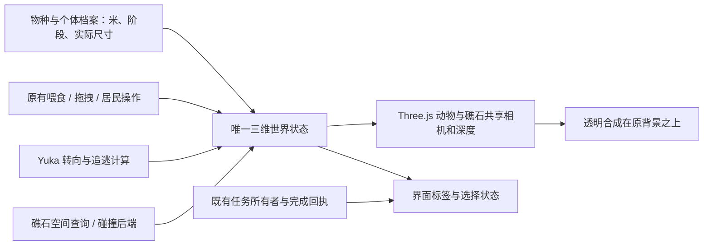
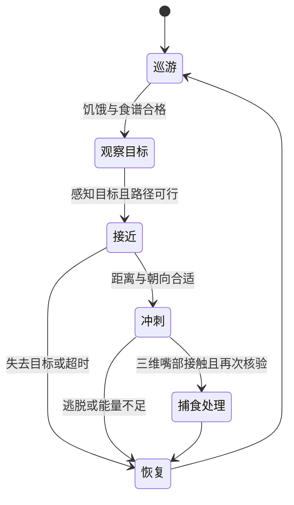

# 真三维海洋：体积、相对尺度、个体成长与追逃捕食技术方案

本轮只调研和制定计划，没有修改 demo、生产实现、设置或依赖。用户体验后的新要求是：消除纸片感；物种间比例一致；同种个体也有幼体、亚成体、成体及体型差异；支持合理的追逐、逃跑、躲藏和捕食。背景优先、固定造景默认关闭、现有喂食 / 拖拽 / 任务水母能力继续作为约束。

## 1. 可行性与当前问题

可以实现，但需让动物与礁石进入同一个三维空间；仅给现有 Canvas 鱼增加阴影或缩放不能补齐几何体积、深度遮挡和实体碰撞。

当前源码的具体问题：

| 位置 | 发现 | 影响 |
| --- | --- | --- |
| `test/demos/reef-lab-20261021/reef-adapter.mjs`、`lab.css` | 礁景在 z-index 1 的底部 WebGL 画布，动物在 z-index 2 的 Canvas；`shore()` 返回 null | 两层没有共享深度，鱼总在礁石前面，也不知道礁石实体 |
| `js/aquarium-core.js:131` | 小鱼 `len` 单独设像素值，大动物基本按 56 px/m | 不能形成统一相对尺度 |
| `lengthOf / spawnGroup` | 个体尺寸只依赖种类长度、视口缩放、模拟深度 z | 没有独立个体体长或成长档位；远近变化不等于年龄差 |
| `normalizeEntries` | 存储只保留 id / species / addedAt | 随手加年龄字段会被旧规范化和后续写入丢掉 |
| `js/aquarium-predation-core.js` | 已有巡航→追逐→冲刺→处理→恢复及猎物逃跑，但距离在二维中计算，资格用物种的 meters | 可能出现屏幕重叠但三维距离很远仍捕到；同种幼体与成体资格一样 |
| demo 的 `bootstrap.mjs` | `aquariumPredation: false`，且演示名单没有锤头鲨 | 之前的浅礁 demo 没有展示捕食，不应称作捕食已验收 |

只读计算得到，尚未考虑远近缩放时：

| 当前登记项 | 画面基准长度 | 登记尺寸 | 像素 / 登记米 |
| --- | ---: | ---: | ---: |
| 霓虹灯鱼 | 16 px | 0.04 m | 400 |
| 小丑鱼 | 30 px | 0.11 m | 272.73 |
| 蓝吊 | 22 px | 0.20 m | 110 |
| 海龟 | 70 px | 1.25 m | 56 |
| 小锤头鲨 | 140 px | 2.5 m | 56 |
| 鲸鲨 | 504 px | 9 m | 56 |

因此当前鲸鲨 / 小丑鱼像素比是 **16.8**，登记尺寸比是 **81.82**。这里是代码数据对照，不宣称登记值已完成生物学校准。蝠鲼的尺寸还涉及盘宽、海龟涉及甲长，不能统一叫“体长”直接比较。

Deskworlds 的[布局](https://github.com/chaseleantj/deskworlds/blob/335d6c1aeb59b338b1cc59d734dc6eb87a596a88/scenes/reefscape/src/layout.js)明确 1 单位 = 10 cm，TANK 横向 19.3 单位，即 **1.93 m**。它的局部礁景可以作为前景资产，但不能把 9 m 鲸鲨也限制在这口鱼缸里。

## 2. 推荐架构：一个世界、一份姿态、一个深度缓冲

建议下一轮继续在独立 demo 中试验：



- **统一全视口透明渲染层**：鱼和礁石放入同一个 Three.js Scene / Camera / Renderer。保留原壁纸图层，不设置三维背景色、不加全屏不透明背板。
- **动物使用真实网格**：身体闭合、有厚度和法线；鱼鳍可薄但具有空间方向；转身使用三维姿态，不再横向压扁翻面。侧扁鱼正对时变窄是正常形态，但头、眼、左右胸鳍与体表遮挡仍应成立。
- **统一遮挡**：鱼身、石块主要走不透明深度写入；细鳍 / 触手透明单独处理，不能把整条鱼都做成低透明度贴片。鱼经过石后应自然消失，游出才出现；半透明物体仍需专门验证排序，单纯加 Scene 不会自动解决全部透明问题。
- **唯一模拟状态**：新模式下由三维 World 接管该批动物；现有二维 World 与新 World 不同时驱动同一条鱼。对外继续使用居民、喂食、抓取和回执适配，避免两份事实或两次积分。
- **唯一调度**：宿主调度固定模拟步长与渲染插值；隐藏、取消、切换模式、资源释放仍由宿主负责。Yuka 只贡献转向结果，不额外调用另一套全局更新循环。

真实遮挡与真实碰撞是两项能力：深度缓冲解决看见什么，空间查询 / 碰撞处理解决能走到哪里。

## 3. 直接可复用的真 3D 动物

已读固定提交的 [fish-model.js](https://github.com/chaseleantj/deskworlds/blob/335d6c1aeb59b338b1cc59d734dc6eb87a596a88/scenes/reefscape/src/fish-model.js)。公开导出：

- `makeFishGeometry(kind, res)`：带厚度的程序化身体与鳍等几何。
- `createFishSchool(scene, simulation)`：支持 clown / chromis / anthias，使用 InstancedMesh、近远细节和逐实例游动参数。

**优先拿它的小丑鱼做真三维样板**。其 clown 指向 **Amphiprion percula**，不是所有“小丑鱼”的通用模型；不能把 chromis 换个颜色就称蓝吊。蓝吊、鲨类、海龟、蝠鲼仍需匹配物种的可授权模型或新增上游支持。

可薄适配的实例字段已有 `position / size / yaw / pitch / roll / phase / tailAmplitude / pectoral / rowing / bend / rank`。但接口有实际限制：

1. `size` 是原网格的缩放倍数，不能直接传入米值；先量基准网格的指定测量锚点，再换算。
2. `createFishSchool` 创建时过滤并固定成员数组、实例容量与部分外观信息。放入 / 捞出后需要按批次重建和释放，不能假设修改 simulation.fish 数组就自动生效。
3. GPU 形变不会自动同步 CPU 拾取或碰撞形状；用绑定到同一姿态的身体代理体做命中与碰撞，不能用未变形的静态网格冒充精确命中。
4. 幼体的头身比、眼睛、鳍和花纹不一定只是成体等比例缩小。若没有对应形态资产，必须标为体型变体，不声称完成了幼体解剖还原。
5. 当前正式导出中没有单独的公开 fishMaterial 工厂；优先用完整公开 createFishSchool，不直接依赖未导出的材质函数。

以后采用带骨骼 GLB 时复用 Three.js 的 GLTFLoader、[SkinnedMesh](https://threejs.org/docs/pages/SkinnedMesh.html) 和 AnimationMixer。是否支持骨骼 / morph 取决于模型本身，不能由一张生图自动得到。

## 4. 相对尺度与个体成长

### 4.1 单位与测量口径

新世界统一 **1 world unit = 1 m**。每个资产记录它的原始单位和测量锚点，导入时只做一次单位变换。Deskworlds 的坐标、速度、水深和光学系数必须一起适配；不能只给网格乘 0.1，却让水流、碰撞或每 10 cm 的吸收系数仍按旧单位工作。

为少改上游，可在适配层保留其分米计算：世界输入除以 0.1，长度/速度输出乘以 0.1；或者在独立组件内保持分米坐标并通过父节点统一变换。两种不能混用。上游材质内部使用世界位置，需用固定相机与灰卡验证变换后的光学一致性，不能认为 Group.scale 足够。

物种档案至少有：
- 科学名、栖息地、食性、允许的生活阶段；
- 尺寸度量：总长 TL、标准长 SL、直线甲长 SCL、盘宽 DW 等；
- 来源数值的“典型 / 最大 / 成熟阈值 / 新生”含义及来源时间；
- 模型对应锚点、身体宽高、口部与捕食接触代理体。

不能用统一常数把所有 SL 换算成 TL；不能拿蝠鲼盘宽当作鱼的头尾长度。

### 4.2 已核到的生物依据与剩余缺口

| 对象 | 一手科普 / 专业来源提供的信息 | 对设计的约束 |
| --- | --- | --- |
| 真小丑鱼 Amphiprion percula | [Georgia Aquarium](https://www.georgiaaquarium.org/animal/clown-anemonefish/)列尺寸 7.6 cm，并说明群体有基于体型的层级 | 不能把同一海葵上的个体都做成完全一样；该页面未给完整幼成年尺寸分布，不能据此编年龄曲线 |
| 蓝吊 Paracanthurus hepatus | [Georgia Aquarium](https://www.georgiaaquarium.org/animal/palette-surgeonfish/)列可长到约 25 cm，雄 / 雌成熟尺寸约 11 / 13 cm；幼鱼常靠近珊瑚丛，受惊会躲入枝间 | 科学名要与黄尾蓝体匹配；不能误用另一个 Blue Tang（Acanthurus coeruleus）的数据 |
| 绿海龟 Chelonia mydas | [NOAA](https://www.fisheries.noaa.gov/species/green-turtle)列典型成体约 3–4 英尺，并说明阶段、栖息地和体表差异 | 资产应以甲长口径校准；壳、头、鳍总包围盒不是甲长；不同阶段不能只有同一纹理缩放 |
| 巨型蝠鲼 Mobula birostris | [NOAA](https://www.fisheries.noaa.gov/species/giant-manta-ray/management)以盘宽描述尺寸，且为滤食者 | 分开记录盘宽 / 身长；不能因“大”就加入追咬小鱼的捕食组 |
| 路氏双髻鲨 Sphyrna lewini | [Florida Museum](https://www.floridamuseum.ufl.edu/discover-fish/species-profiles/scalloped-hammerhead/)给出出生尺寸 31–57 cm 及种内差异 | 现有“小锤头鲨”名字不够精确；要选定物种后才能校准，不能混用小型窄头双髻鲨与大型双髻鲨 |
| 鲸鲨 Rhincodon typus | [Georgia Aquarium](https://www.georgiaaquarium.org/animal/whale-shark/)说明滤食方式与近岸 / 外海活动 | 放在开阔水域；不套追咬型捕食规则 |

河豚、神仙鱼等现有泛称还没有锁定精确物种；霓虹灯鱼属于原有混养装饰集合。三维海洋方案不能悄悄替换用户旧条目；先限定一小组已标定海水物种做真实性验收。

### 4.3 每一条鱼有稳定的个体档案

建议的概念字段如下，尚未写入现有存储：

```text
individualId / residentEntryId / speciesId
lifeStage: juvenile | subadult | adult
ageDays: 可空（未知就不编造）
sizeMetric / measureMeters / bodyDepthMeters / bodyWidthMeters
variationSeed / morphologyVariant / sourceProfileVersion
```

- 先选生活阶段，再在该阶段的经审核区间里采样；允许阶段分布重叠，也允许性别与种群影响尺寸。不能用所有物种共同的“成体 × 0.5”生成幼体。
- 初始建议做“混合阶段群体”，每条鱼的稳定随机种子决定体型和轻微外观差异；不在每帧随机，不因为缩放窗口、切换画质或重开 demo 就变体型。
- 资料不够时先用“小 / 中 / 大体型”表述，不仅凭外观猜幼成年。给蓝吊安排 6 cm、14 cm、22 cm 三个示例，可用来观察种内差异；这三个数是演示取样点，不是统计分布或年龄推算。
- 第一轮只表现不同阶段共存。实时成长放在后续：没有物种参数时不启用；若采用 von Bertalanffy 等生长模型，L∞、k、t0 必须有对应种群与度量依据，不能抄通用参数让鱼几分钟长成年。
- 个体体长同样驱动碰撞代理、最小通过间隙、转弯半径、动画节奏与捕食资格，不能只改 mesh.scale。

存储升级必须单独设计：现有规范化会丢弃新增字段。隔离原型先用完整 fixture；正式阶段由原有串行 mutate 入口统一持久化，做显式版本迁移、备份和回滚。不能另建一份可独立写入的居民事实库，也不能把永久画像更新混进每帧仿真。

### 4.4 真实大小与看起来多大

统一透视下，近似的投影高度满足 `pixels ≈ focalPixels × physicalSize / cameraDepth`（仅用于同向尺寸的估算，实际以投影矩阵为准）。

同深度 9 m 与 0.1 m 物体就是约 90:1。若希望小鱼可看清，应让它在近景、让大动物位于远处，或提供观察镜头；不要偷偷把小鱼画大而仍声称统一比例。点击目标可做更大命中区域、轮廓提示或列表定位，不改变可见身体尺寸。

前景保留按真实比例校准的局部礁石，小鱼活动在近处；大型访客在相连的开阔水域。观察模式可以放大整组与尺标，但正常模式保持统一相机。背景图不跟着相机缩放。

## 5. 遮挡、碰撞与躲藏

### 5.1 渲染遮挡与拾取

鱼与礁石共用深度。鼠标使用 Three.js [Raycaster](https://threejs.org/docs/pages/Raycaster.html)，按距离判断可见目标：被不透明礁石挡住的鱼不能穿透点击；居民列表仍可定位。任务标签保留在界面层，但标签不能使隐藏的鱼被误选。

较小鱼可藏进缝隙，大鱼无法通过；判断基于完整身体代理体与通道净空，不仅检查鱼中心点。转身也要验证姿态占用空间，尤其是蝠鲼翼展和大鱼弧线。

### 5.2 分层复用，避免自写物理引擎

| 需求 | 优先方案 | 已查能力与边界 |
| --- | --- | --- |
| 近距避障、寻找开阔路径 | Deskworlds clearWater / clearSegment / ReefNavigation | 已读[导航源码](https://github.com/chaseleantj/deskworlds/blob/335d6c1aeb59b338b1cc59d734dc6eb87a596a88/scenes/reefscape/src/navigation.js)。固定 margin=0.48 原单位，采用椭球代理；导航图本身固定净空，不能让所有体型共用而声称尺寸感知 |
| 精确可见性、静态礁网格空间查询 | three-mesh-bvh | [公开 API 与实例](https://github.com/gkjohnson/three-mesh-bvh)包含 MeshBVH、raycastFirst、intersectsSphere、shapecast；提供角色碰撞示例。它是查询库，不是完整动力学求解器 |
| 追踪、逃离、群游转向 | Yuka | [官方模块](https://github.com/Mugen87/yuka)导出 PursuitBehavior、EvadeBehavior、ObstacleAvoidanceBehavior 等；只使用其计算结果，项目决定食性、预算和状态迁移 |
| 高速扫掠、可靠接触停止 / 滑动 | 单独评估 Rapier | 官方 World.castShape 支持完整形状扫掠，控制器支持 move-and-slide；[控制器](https://rapier.rs/docs/user_guides/javascript/character_controller/)明确**只支持平移、不支持旋转运动**，所以转身不能直接宣称被它解决 |

建议先完成无 WASM 的三维遮挡、尺寸感知导航和保守非穿透探针。BVH 的 shapecast 是自定义形状遍历回调，**不能因为名字相同就当作 Rapier 的连续扫掠**。若高速穿越、旋转扫掠或复杂拱洞达不到验收，优先在独立探针评估 Rapier；不要临时造一套自称可靠的连续碰撞引擎。

Rapier 是 WASM，包括 compat 包也只是把 WASM 内嵌，并不消除 CSP 约束。当前正式扩展 CSP 不变；是否给正式扩展启用 WASM 属于另一个明确决策。本轮只记录方案，没有修改权限。即便采用 Rapier，它也不自带海洋生物的肌肉、流体或浮力真实性。

库候选：现有 Three r180 + 固定 Deskworlds 提交；three-mesh-bvh **0.9.16** 已核 release 与该 tag 的 package.json；Yuka 仓库 package 为 **0.7.8**，在线手册仍显示 0.7.7、latest release 接口无结果，实施前需核 npm 包及锁文件。Rapier 文档当前为 JavaScript 0.21，未确认拟用 npm 包的精确发布版本，暂不写死部署版本。本轮未安装或跑这些新库。

### 5.3 固定造景关闭时的同一语义

关闭造景必须同时撤掉对应颜色、深度写入、碰撞体、导航障碍与遮蔽物，不能留下隐形墙。使用场景版本，在一次模拟步边界原子切换；正在躲藏 / 追逐 / 抓取的引用重新验证。

固定造景覆盖范围由构图和布局控制，不再让整个三维动物场景跟着一个底部 CSS 画布裁切。调整造景范围不能改变动物的米制体长。若片元被隐藏，相关碰撞有效区也必须有一致的解释；不能仅靠 CSS mask 隐藏仍在挡路的实体。

## 6. 大鱼追、小鱼逃与捕食

这部分可以实现，现有二维系统也已有基础。迁到三维后沿用其有界追逐、恢复、捕食间隔和临时补员合同，主要升级空间、感知和个体差异。

### 6.1 不是按“大于”直接判断食物

捕食资格至少同时满足：
1. 物种 / 生活阶段食谱允许；
2. 捕食者本个体的口部尺寸能处理猎物的体深 / 体宽代理（度量要兼容）；
3. 双方活跃、没有被用户抓取、未进入 UI 操作或临时离场；
4. 目标是生态动物，任务水母结构上不传入猎物集合。

身体长度可用于粗筛，但口径需要保守代理和来源；当前 `gape × 物种 meters` 不是精确生物口裂模型。同种幼年捕食者与成体可能有不同可捕目标。鲸鲨与蝠鲼走滤食行为，不因体型大进入追咬模式。

### 6.2 有开始，也会失败的行为链



猎物：感知威胁 → 警戒 / 分散 → 逃离 / 躲藏 → 短暂观察 → 回到栖息点或重新聚群。感知距离、反应延迟和躲藏偏好按物种配置；追逐者只记短期最后感知位置，不持续读取遮挡后目标的精确位置做“透视追踪”。这是可解释的游戏感知模型，不宣称模拟鲨鱼全部感官。

复用 Yuka 的预测追逐和逃逸，不让模型实时写脚本或做每帧 LLM 决策。[PursuitBehavior.calculate](https://github.com/Mugen87/yuka/blob/master/src/steering/behaviors/PursuitBehavior.js)已读取，提供基于速度的拦截方向；项目仍要限制最大速度、加速度、转弯半径与预测时域。

当前 `strikeBoost` 会按猎物速度提高捕食者倍率（有上限）。新方案不能为了确保戏剧效果持续保证大鱼比任何猎物更快；允许猎物凭加速、转弯、群体行为、距离和掩体逃脱。捕食不是每次必成，也不固定几秒演一遍。

### 6.3 捕到必须有三维证据

需要嘴部运动体积与猎物代理真实接触、空间路径没有礁石阻挡、资格再次通过，才产生一次捕食事件。只有屏幕重叠或二维距离变小不算捕到。

同一模拟步里两条捕食者接触一个猎物时，由唯一 World 原子登记一次捕获，按稳定规则解决竞争。事件有世界代际、捕食者与猎物 ID；界面只投影结果，不发出第二次捕食。被用户抓取后目标立即失效，释放到合法位置再参加生态仿真。

继续保留本项目“捕食只影响内存展示、原居民条目不自动永久删除、过一段时间补回”的陪伴规则。补员不是对真实死亡过程的模拟，不影响任务或个人记忆；任务水母永不成为猎物。现有 12 秒追逐等参数可作初始有界规则，不能当科学统计或不经校准直接移植到新尺度。

## 7. 交互与任务水母

- 喂食仍由原入口和限额产生事件，饲料改为三维位置与沉降 / 水流；动物嘴部接触后才吃到，界面“已投放”与“已吃到”分开。
- 鼠标射线抓取后使用可见拖拽代理，避免鱼被礁石遮住而无法操作；用户托举期间与生态碰撞 / 捕食分离。释放回水域须找合法落点，不能塞进石内。网兜仍由原 UI 与串行存储移除流程负责。
- 任务水母保留原任务版本、取消、确认和完成回执。下一版可将钟罩 / 触手换为真正三维呈现，任务文字仍在界面层；业务所有者不变，视觉碰撞不能触发任务完成。
- 水母是任务交互对象，不能从真实海洋生物的食谱推导它可被吃。任务完成和生态捕食是两条完全不同的事件链。

## 8. 验收方向与取舍

必须有“尺标同深度模式”和“自然透视模式”两种检查视图；前者校准真实比例，后者检查观感。先只做一种鱼、多个体，再加礁石，然后加捕食者。完整执行顺序见[执行计划](../superpowers/plans/2026-10-21-aquarium-3d-scale-ecology.md)。

重点验收：
- 正面、侧面、背面、俯视和 3/4 视角都有正确体积；靠近礁石时发生可信遮挡。
- 世界尺寸不随屏幕、DPR、画质或摄像机改变；刷新保持个体档案。
- 同一通道小鱼能通过，大鱼不能；关闭造景后没有隐形阻挡。
- 目标隔着礁石时不隔墙吞食；同屏不同深度时不凭重叠捕获。
- 追逐有成功、失败、放弃和恢复，不能无限追或反复锁死同一猎物。
- 原有居民、任务水母和预算不因视觉故障重复写入；页面隐藏停止推进。
- 先保留 40 条渲染鱼、2 个大型条目的现有上限；细节按距离降级，身体尺寸、碰撞体与身份不随 LOD 改变。性能数字等隔离探针实测，本轮没有宣称提升。

自查：本轮只新增调研与计划文档；没有变更业务实现、demo、权限、存储结构或运行配置。方案保留真实数据与回执边界；新依赖、模型许可证、单位换算与碰撞极端情况均设为实施前的验收项。
