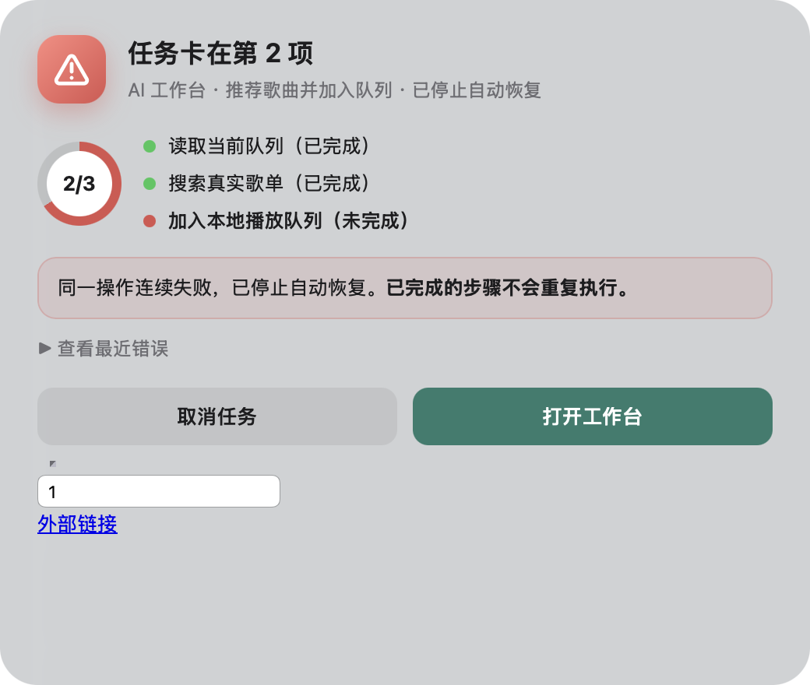
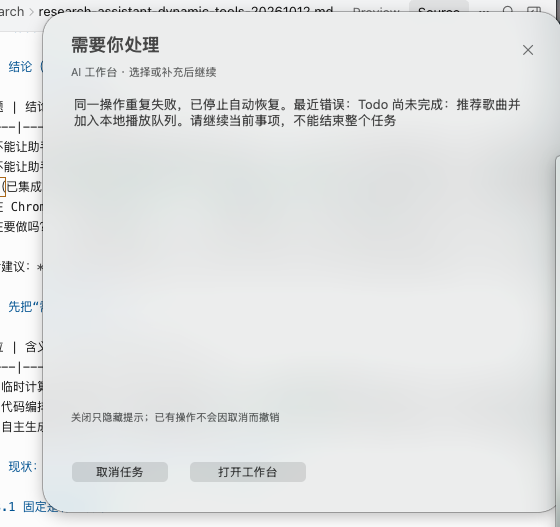
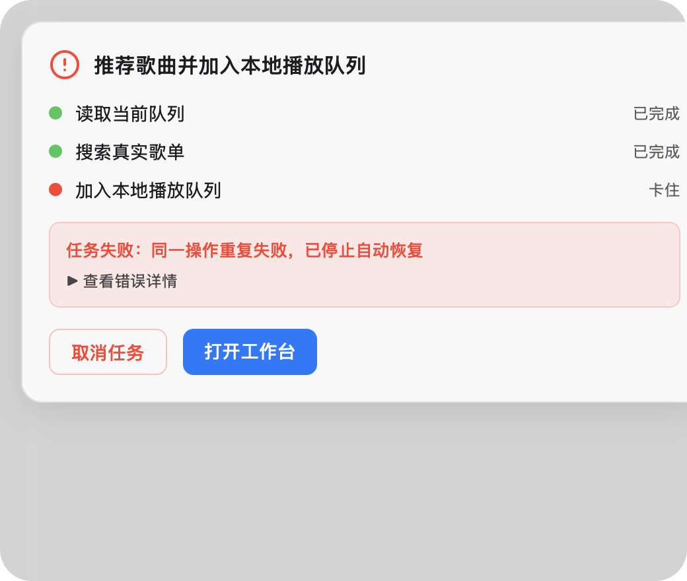
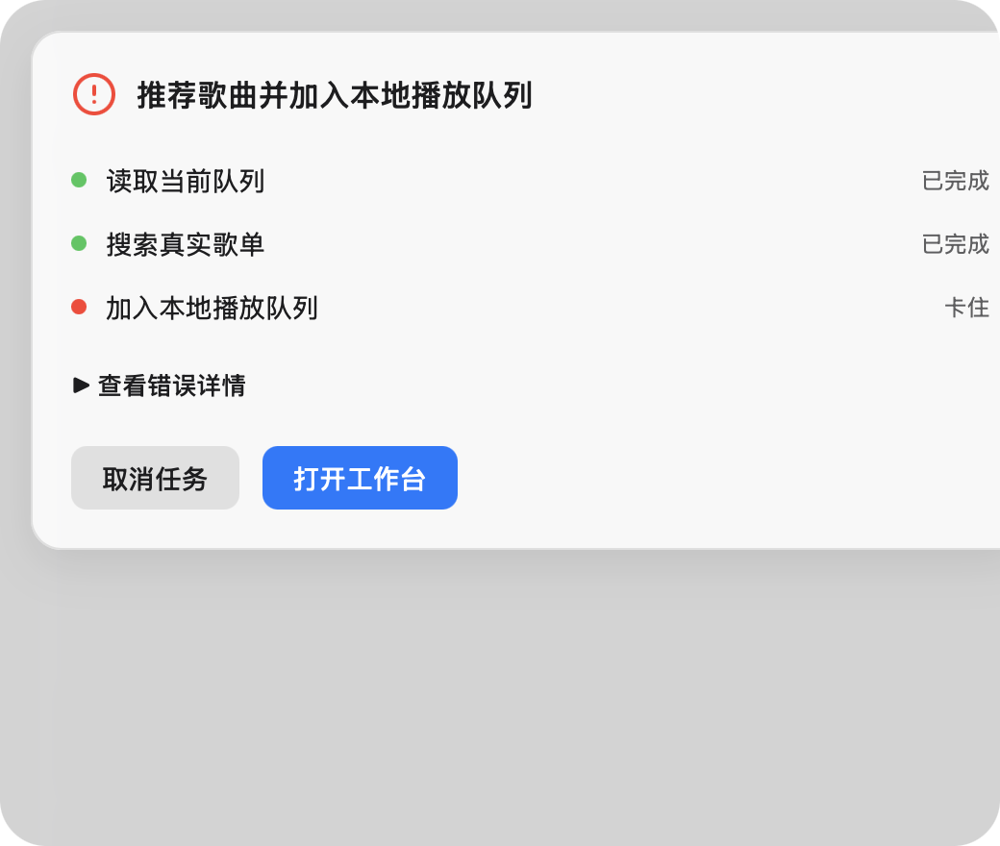

# 原生弹窗提示 UI 的“自主编码”可行性调研

> 本文只调研。没有改动 `desktop-reminder/`、`js/assistant-confirmation.js` 或协议；唯一新增的是 `docs/research/assets/native-popup-ui-20261012/` 下的研究素材（截图、一个可复现的 WebKit 锁定实验，以及一次本机模型生成实验的样本与脚本，不参与构建与测试）。

## 1. 结论（先给答案）

1. **“让模型写 UI”可以做，但不是同一件事的一档，而是四档，风险差别很大**：人工模板 → 声明式卡片（模型只填 JSON）→ 模型写 HTML/CSS（无 JS，锁定的 WKWebView）→ 模型写原生代码。前两档几乎没有新风险；第三档**实测可以锁住**（见 §5）；第四档等于任意本机代码执行，**拒绝**。
2. **最该先做的不是“模型生成”，而是修掉截图里已经存在的几处硬伤**（§2）：窗口固定 520:500 比例导致大片空白、`inspect` 状态下副标题仍写“选择或补充后继续”（它是 Swift 里的常量，不随状态变）、两个按钮没有主次。这些用人工设计的分状态模板就能解决，也是任何“生成式 UI”的底座。
3. **推荐路线**：U0（分状态模板 + 自适应高度）→ U1（声明式卡片 `presentation`，模型只给结构与措辞，原生固定组件渲染）→ 视需要再上 U2（HTML/CSS）。U2 要进入产品，须把 §5 的诱饵矩阵作为永久回归用例，且**不得用于 `review` 确认卡**（用户必须看清真实操作事实）。
4. **和上一份“自主写工具”调研的关系**：UI 生成**不需要**也不应使用 `compute.run` 沙箱——HTML/CSS 是数据，不是要执行的代码；安全靠“渲染器锁死 + 动作 ID 由执行器拥有”，不靠 QuickJS。
5. **本机模型的延迟决定了它只能“先出默认卡、后升级”**（§7）：不能让生成挡住确认、选择或取消。

## 2. 现状与问题（以你给的截图为准）

| 编号 | 截图里看到的 | 原因（已核对代码） |
|---|---|---|
| P1 | 约六成区域空白，内容只有两行字 | `desktop-reminder/confirmation-view.swift:43,53`：初始 520×500、`contentAspectRatio = 520:500`，所有坐标按 `bounds.width / 520` 等比缩放，不随内容变高 |
| P2 | 副标题“AI 工作台 · 选择或补充后继续” | `confirmation-view.swift:26` 是**常量**；标题随 `kind` 映射（`:135`），副标题从不更新。`inspect`（失败/中断核对）状态没有候选也没有输入框，副标题与卡片内容不符 |
| P3 | 正文是引擎原样错误串“同一操作重复失败，已停止自动恢复。最近错误：Todo 尚未完成：…” | 卡片只有 `message ≤ 1500` 一个文本字段（协议 v4），没有结构化的“已完成 / 卡在哪 / 你能做什么” |
| P4 | 两个小按钮同一视觉权重，“取消任务”与“打开工作台”不分主次 | 按钮样式由原生端固定；`取消任务` 在 `inspect` 状态是破坏性动作，却与安全动作等权 |
| P5 | 没有任务进度（第几项、哪些已完成） | 协议没有承载；Todo 进度只在工作台贴片里 |

P1/P2/P4 是纯布局与文案问题，**不需要模型**。P3/P5 需要“把事实结构化投影到卡片”，同样可以由执行器（而不是模型）完成。模型真正能增加价值的是：根据当前情形选择**重点与措辞**（例如“只差最后一步，已完成的不会重做”）。

## 3. “自主编码的 UI”可以是什么：四档

| 档 | 模型产出 | 谁渲染 | 表达力 | 新增风险 | 判断 |
|---|---|---|---|---|---|
| U0 | 无（人工设计的分状态模板、自适应高度、主次按钮、状态色与图标） | AppKit | 中 | 无 | **先做**，也是 U1/U2 的降级底座 |
| U1 | 声明式卡片：`tone`、`icon`、`title`、`sections[]`（text / steps / progress / callout / key-value / code）、`actions[]`（只引用执行器给的 `choiceId` 与样式枚举） | AppKit 固定组件 | 中高（组合出结构与重点） | 极低：只是数据，沿用现有合同式校验 | **推荐的“自主”第一档** |
| U2 | HTML + 内联 CSS（**无 JS、无外链**） | 锁定的 `WKWebView` | 高（任意排版、渐变、环形进度、SVG 图标） | 低，但依赖多层锁定与净化；多了 WebKit 依赖 | 可选第二档；§5 给出实测依据 |
| U3 | 含 JavaScript 的网页 | `WKWebView` | 最高 | 高：脚本执行、更多出口与旁路 | **不做**；没有任何需求必须用脚本 |
| U4 | 模型写 Swift/AppKit 代码，现场编译运行 | 原生 | 最高 | 任意本机代码执行，权限等同用户（Native Messaging 宿主以用户身份运行） | **拒绝**；违反 AGENTS.md 对模型自写代码的限制，而且需要编译器、签名、公证 |

“符合当前想提示的 UI”的需求用 U1 就能覆盖大部分：失败卡强调“卡在哪一项、已完成的不会重做”，确认卡强调“将要删除的对象与数量”，选择卡强调“候选的区别”。U2 的增量价值是**视觉自由度**（例如截图风格的环形进度、渐变徽标），代价是更大的验证面。

## 4. 现有原生弹窗的约束（设计必须兼容）

- 原生是 AppKit-only 的 accessory 应用：`desktop-reminder/main.swift`、`confirmation-view.swift`、`countdown-view.swift`；Native Messaging 协议 v4，旧 v3 卡片兼容（`docs/technical/assistant-interaction-native-20260920.md`）。
- 卡片字段：`id, taskId, version, message ≤ 1500, expiresAt, kind, status, allowText, choices[] ≤ 96, inputPlaceholder`；动作 `select / reply / cancel / open / confirm`。入站帧 256 KiB（扩展侧卡片上限 240 KiB），出站 64 KiB；文字回复 ≤ 500 UTF-16 单元。
- **动作由执行器拥有**：选择/回答/取消经 `Engine.respond()` 回到原串行入口，绑定任务、版本、状态、候选和有效期；原生端不执行业务、不建第二份任务状态。模型不能声明已授权。任何生成式 UI 都必须保持这一点：它只能**引用**执行器给出的 `choiceId`，不能创造、改名为另一个动作，也不能改变动作的语义。
- 面板窗口：无边框 `NSPanel`，`.nonactivatingPanel`（不抢前台焦点），`NSVisualEffectView` 磨砂底，可缩放（最小 468×450，最大 780×750），位置与尺寸有记忆。

## 5. 实测：模型写的 HTML/CSS 能否被安全地显示（U2 的可行性）

方法：一个 Swift 5.8.1 的 AppKit accessory 小程序（`docs/research/assets/native-popup-ui-20261012/spike/spike.swift`）在无边框 `NSPanel` + `NSVisualEffectView` 里放一个 `WKWebView`，用 `loadHTMLString(_, baseURL: nil)` 载入“模型风格”的卡片；卡片里**故意塞入诱饵**，每个诱饵都指向本机一个计数 HTTP 服务（只要收到请求就算外泄）。两张卡：`sample-card.html`（10 个诱饵：内联脚本 fetch、`onerror`、远程图片/样式表、iframe、CSS 背景、`@import`、外部链接、meta refresh、表单）和 `bait-wide.html`（35 个诱饵，覆盖 CSS 的 `url()` 各种属性、`@font-face`、`<link rel=…>`、`srcset/picture`、SVG `image/use`、`video/audio/track`、`object/embed/iframe/srcdoc`、`input type=image`、`<base>` 相对路径、`a[ping]`、`target=_blank`）。动作链接用 `action://choice/<id>`，点击由程序化 `click()` 触发（页面脚本关闭时，应用侧 `evaluateJavaScript` 仍可用）。

### 5.1 单卡 10 个诱饵：逐层拆掉防御

| 配置 | JS | 内容规则 | 导航审查 | CSP | 泄漏（到达诱饵服务的请求数 / 10） | 备注 |
|---|---|---|---|---|---|---|
| A 完整 | 关 | 是 | 是 | 是 | **0** | 页面脚本未运行；`action://` 被截获并映射 |
| B 去 CSP | 关 | 是 | 是 | 否 | **0** | 说明 CSP 不是必需，只是多一层 |
| C 无规则 | 关 | 否 | 是 | 否 | 4 | 图片、样式表、CSS 背景、`@import` 漏出 |
| D 仅 CSP | 关 | 否 | 否 | 是 | 1 | 子资源被挡，但**外部链接点击导航**漏出 |
| E 开 JS | **开** | 是 | 是 | 否 | 0 | 脚本确实运行了（`onerror` 改了 DOM），但 `fetch` 被规则拦下 |
| F 全开 | 开 | 否 | 否 | 否 | 8 | 对照：诱饵本身有效 |
| G 仅关 JS | 关 | 否 | 否 | 否 | 6 | **只关 JS 远远不够** |

### 5.2 宽卡 35 个诱饵

| 配置 | 泄漏（/35） |
|---|---|
| W-B：JS 关 + 内容规则 + 导航审查 | **0** |
| W-C：JS 关 + 仅导航审查 | 20 |
| W-G：仅关 JS | 23 |
| W-F：全开（JS 开） | 25 |

W-F 里 25 个诱饵有效；其余 10 个即使全开也没有触发（`link rel=prefetch/icon/manifest`、`svg use`、`meta refresh`、需要用户提交的两个表单入口、`target=_blank` 弹窗等），**它们不能算作“被挡住”的证据**，只在审查/净化层面保持警惕。`a[ping]` 是真实旁路：无规则时点击会向第三方 POST；内容规则的 `ping` 类型把它挡住了。

### 5.3 锁定所需的最小组合（实测）

1. `WKWebpagePreferences.allowsContentJavaScript = false`：页面内联脚本与事件处理器都不运行；应用侧 `evaluateJavaScript` 仍可测量高度（`document.body.getBoundingClientRect().height` 返回 364，窗口原为 440，**可据此自适应窗口高度，解决 P1**）。
2. `WKContentRuleListStore` 编译一条规则：对 `image / style-sheet / script / font / raw / svg-document / media / popup / ping` 全部 `block`（`url-filter: .*`）。这是官方内容拦截机制，编译约 40–100 ms。
3. `WKNavigationDelegate.decidePolicyFor` 只放行首次 `about:blank` 与 `action://` 方案；所有子框架、外部链接、`target=_blank` 一律 `.cancel`。`action://choice/<id>` 的 `<id>` 必须出自执行器给的 `choices[]`，否则丢弃。
4. `WKWebsiteDataStore.nonPersistent()`；不设置 `baseURL`；`createWebViewWith` 返回 `nil`。
5. 以上**缺一层都有实测泄漏**（见 5.1 的 C/D/G）。CSP `<meta>` 是额外一层，不是必要层。

另有一个**净化层**不可省：网络被挡住不代表页面干净——表单输入框、外部链接文字、占位破图标仍会显示（见 `locked-down-card.png`）。仓库已经 vendored DOMPurify 3.2.5（`vendor/purify.min.js`，`js/markdown-renderer.js` 在用），应在**有 DOM 的扩展页**里复用它，而不是自写净化器。注意：DOMPurify 默认允许 `<style>` 与 `style` 属性，**不解析 CSS 里的 `url()`**（其文档与 `demos/hooks-sanitize-css-demo.html` 都专门演示用钩子按属性白名单过滤，或 `FORBID_TAGS: ['style']` / `FORBID_ATTR: ['style']`），所以 WebKit 内容规则与 DOMPurify 的 CSS 钩子要同时在。



*图：A 配置下的真实窗口截图。可以看到右下残留的诱饵表单输入框与“外部链接”文字——这是需要净化层处理的部分。*



*图：当前实际的卡片（你提供的截图）。*

### 5.4 成本（单次实测，非基准测试）

- `WKWebView` 创建约 50–100 ms；从 `loadHTMLString` 到 `didFinish` 约 0.25–0.9 s（含首次拉起 WebContent 进程）；规则编译约 40–100 ms。
- 内存：宿主进程 RSS 约 62–75 MB，另出现 3 个 `com.apple.WebKit.*` 辅助进程，合计约 82–113 MB。**卡片关闭后是否及何时释放没有测**；现有 AppKit-only 宿主的基线 RSS 也没测，无法给出“相对增量”。
- 要链接 `WebKit.framework`（系统库）；宿主目前没有这个依赖。

### 5.5 实验的局限（必须读）

- **没有做真实鼠标/键盘点击**，只用应用侧程序化 `click()`；它走同一套导航审查，但不等价于真实交互。
- 只有一台 macOS（darwin 25.5.0）、一个 WebKit 版本；规则类型 `ping` 等在更旧系统上的可用性没验证。
- 只测了亮色模式；深色模式、VoiceOver、动态字体没验证。
- DNS 预取/`preconnect` 不会产生 HTTP 请求，计数服务看不到，**没有验证**。
- 没测 DOMPurify 钩子本身（需要 DOM；仓库当前只在 Markdown 渲染里用默认配置）。
- “宽卡”里 10 个诱饵全开也不触发，只能说明这个环境下它们不是有效旁路。

复现：`OUT=$(mktemp -d); swiftc -O spike.swift -o "$OUT/spike"; SPIKE_OUT="$OUT" python3 run.py`（在 `docs/research/assets/native-popup-ui-20261012/spike/` 下；需要 GUI 会话。窗口截图用 `screencapture -l`，没有授权只会让这一步失败，不影响请求统计；产物写入 `$OUT`，不会写进仓库）。

## 6. 方案对照与设计不变量

### 6.1 U1（声明式卡片）草案

在协议 v4 卡片上加一个**可选**字段 `presentation`（旧原生组件忽略它，仍显示普通卡；沿用“先 `ping` 核对协议版本”的既有降级方式）：

```
presentation: {
  schema: 1,
  tone: 'neutral' | 'info' | 'warning' | 'danger',
  icon: 'alert' | 'check' | 'question' | 'music' | 'bell' | …(固定枚举),
  title: string(≤40), subtitle: string(≤60),
  sections: [ { type:'text', text }, { type:'steps', items:[{ label, state:'done'|'blocked'|'todo' }] },
              { type:'progress', done, total }, { type:'callout', tone, text }, { type:'kv', rows:[{k,v}] } ],
  actions: [ { choiceId, style:'primary'|'secondary'|'destructive' } ]
}
```

规则：`steps` 的 `state`、`progress` 的数字、动作与对象名**来自执行器的快照**，不来自模型；模型只写 `title/subtitle`、`callout` 与 `text` 这类措辞，并明确标注“AI 说明”。总大小仍在 v4 卡片上限内；超限、字段未知、枚举越界一律整体丢弃，退回普通卡。

### 6.2 U2（HTML/CSS）额外必须具备

净化（DOMPurify + CSS 属性白名单钩子，禁止 `script/iframe/object/embed/form/input/meta/link/base`、事件属性、非 `action://` 链接）→ 扩展侧生成、**原生端再校验并施加 §5.3 的锁定**（不信任扩展）→ 应用侧测量高度后再显示 → 任何一步失败回退普通卡且在卡片上说明“已使用简化样式”。动作链接只允许 `action://choice/<执行器给的 id>`。

### 6.3 不变量（与 AGENTS.md 一致）

- 模型输出是待校验的展示数据，不是授权或事实；`review` 确认卡的“对象/数量/不可撤销”事实块由执行器渲染，**不允许被模型样式遮盖或替换**（建议 `review` 初期完全不走生成）。
- 动作与 ID 由执行器拥有；生成式 UI 只能引用。取消、超时、任务版本变化后，晚到的生成结果直接丢弃。
- 每次生成走现有 Gateway 的受控场景（新增场景须有独立开关、预算、取消、超时与记录），默认关闭；不隐式开启外部模型调用。历史留存默认不保存 HTML 正文。
- 更新原生组件后须重载扩展（与协议 v4 的既有要求一致）。

## 7. 本机模型生成耗时与质量（实测）

方法：本机 `qwen/qwen3.8-27b`（LM Studio，reasoning off，temperature 0，`maxOutputTokens` 3000），走仓库的 `LMStudioProvider`（与产品同一入口）。输入是一份“事实”JSON——截图里那个失败场景：三项进度（读取当前队列、搜索真实歌单：已完成；加入本地播放队列：卡住）、原错误串、两个动作（打开工作台 = safe，取消任务 = destructive）——外加一段“界面设计师”指令：只输出 HTML；禁止 `script/iframe/object/embed/form/input/button/meta/link/base/img`、外部地址与事件属性；宽 520 px、浅色深色都适配；步骤名称与状态不得改动；操作只能是 `<a href="action://choice/ID">`，ID 与文字必须来自事实。生成后用 §5 的锁定 `WKWebView`（JS 关、内容规则、导航审查）真实渲染，并由应用侧点击主按钮。

| 样本 | 生成耗时 | 输出 token | HTML 大小 | 链接合规（2 个，均在白名单） | 违禁构件 | 步骤与按钮文案齐全 | 原错误文本完整保留 | 锁定渲染后内容尺寸 | 点击主按钮的结果 |
|---|---|---|---|---|---|---|---|---|---|
| 1 | 99.9 s | 1533 | 3.8 KB | 是 | 0 | 是 | **否**：被改写——拆成“摘要 + 展开详情”，并去掉了“最近错误：”几个字 | 520 × 321 | `ACTION choice/open-workbench` |
| 2 | 83.2 s | 1314 | 3.4 KB | 是 | 0 | 是 | 是 | 520 × 302 | 同上 |
| 3 | 88.5 s | 1314 | 3.4 KB | 是 | 0 | 是 | 是 | 520 × 302 | 同上；与样本 2 **字节相同** |





*图：模型生成的卡片在 §5 的锁定配置里渲染（窗口 520 × 440，磨砂底；右侧被窗口裁切是这个实验把 16 px 页边距叠在 520 px 卡片上造成的，不是模型的问题）。样本 1 把“取消任务”做成描边红色次按钮、“打开工作台”做主按钮；样本 2 的两个按钮视觉权重也不同。*

结论与限制：

1. **能写，也守得住硬约束**：3/3 通过机器检查（链接白名单、无违禁构件、所有步骤/按钮文案都在、没有把“卡住”写成“已完成”）；但**转述并不可靠**：样本 1 改写了错误串（拆开并丢了“最近错误：”），样本 2、3 才是原样放进 `<details>`——所以错误原文也应由执行器放进卡里，而不是让模型转述。锁定渲染后没有任何意外导航，内容高度 302–321 px，远小于现窗口固定的 500 px，说明“按内容自适应高度”可以解决 P1。点击主按钮解析成执行器拥有的动作 ID。
2. **耗时 83–100 s（约 15 token/s）**。输入只有 444 token，慢在输出 1.3–1.5 k token 的 HTML/CSS。所以它**不能放在关键路径**：必须先出默认卡，生成就绪后原位升级；超过上限就取消生成、保留默认卡。而且只对“用户不会立刻处理”的卡有意义（失败核对、中断）；确认卡和选择卡要的是立刻看清事实，不适合等待生成。
3. **同一事实可缓存**：样本 2、3 字节相同，说明 temperature 0 下同一份事实给出同一张卡；按事实指纹缓存生成结果可以避免重复花费。
4. **U1 会更便宜（未测）**：声明式卡片只让模型写 JSON 结构与措辞，输出量预计是这里的几分之一，生成时间也会按比例缩短；没有实测，不要把它当数据。
5. **局限**：只有一类事实（失败卡）、一个模型、3 个样本；没有对抗性事实（文案里夹带 HTML 或指令）、没有深色模式截图、没有第三方评审视觉好坏；模型这次没有夸大，但这靠指令约束，没有机制保证，因此“进度、对象、数量”这类事实块必须由执行器渲染，模型只写措辞（§6.3）。DOMPurify 钩子仍未实际验证。

复现（需要本机模型与 GUI 会话；产物写入临时目录，不进仓库）：`node docs/research/assets/native-popup-ui-20261012/spike/generate-cards.mjs 3 <outDir>`，再用 `SPIKE_OUT=<dir> python3 docs/research/assets/native-popup-ui-20261012/spike/render_generated.py <outDir>/gen-1.html`（`<dir>` 里先按 §5.5 编译 `spike`）。样本与 `generation.json` 在 `assets/native-popup-ui-20261012/generated/`；`gen-1.html` 是模型的原样输出（含一行行尾空格），为保持证据原样没有清理，若提交时被空白检查拦下可直接忽略这一行。

## 8. 建议的实施顺序（若你决定做）

1. **U0（几乎无风险，先做）**：分状态模板（失败/选择/补充/确认各有标题、图标、色调）；副标题随 `kind` 变化；窗口按内容自适应高度；主次按钮（破坏性动作不抢主按钮）；失败卡显示 Todo 进度（数据来自 Engine 快照）。
2. **U1**：`presentation` 合同 + 原生渲染 + 模型生成场景（默认关）；以 `test/assistant-interaction.test.js` 的风格加合同测试和 `interaction-smoke.mjs` 的原生冒烟。
3. **U2（可选）**：先做 §5 的诱饵矩阵回归（把 `bait-wide.html` 变成永久测试语料），再接 DOMPurify 钩子与原生锁定。
4. 每一步都保留“回到普通卡”的开关与失败回退。

## 9. 证据与未验证项

**已验证（本机，2026-10-12）**
- §5 的两张诱饵卡、七个/四个配置的泄漏计数；A 配置真实窗口截图；JS 关闭时应用侧可测量高度；动作链接的截获与 `a[ping]` 的存在与拦截；创建与加载耗时、进程内存（单次）。
- §7 的生成实验：本机 `qwen/qwen3.8-27b` 对同一份失败事实生成 3 张卡（83–100 s/张）、3/3 通过机器检查并在锁定 `WKWebView` 里真实渲染、主按钮点击解析为执行器的动作 ID；样本 1 改写了错误串。
- 当前卡片的 P1/P2 成因（读代码行号确认）。
- 仓库已有 DOMPurify 3.2.5；DOMPurify 文档对 `<style>`/`style` 与 CSS 钩子的说明（Context7 查询其官方 README 与 demos）。

**未验证**
- 真实用户点击、键盘、VoiceOver、深色模式、旧版 macOS。
- 卡片关闭后的内存释放；现有宿主的基线内存。
- DNS 预取等非 HTTP 外泄；DOMPurify 钩子的实际效果。
- 模型生成 UI 的长期稳定性与多样性（§7 只有一类事实、3 个样本，其中两张字节相同）；对抗性事实（夹带 HTML/指令）下的表现；深色模式与第三方对视觉好坏的评价；U1 的实际生成耗时。
- Chrome Native Messaging 路径下的端到端（本调研没有改动或运行 `desktop-reminder`）。

## 10. 需要你决定的问题

1. 先做 U0，还是直接做 U1？（我的建议：U0 → U1；U2 等 U1 跑起来、确实需要更强视觉再说。）
2. 生成式 UI 是否**排除 `review` 确认卡**？（建议排除。）
3. 如果走 U2：能否接受原生宿主新增 `WebKit.framework`，以及卡片显示期间约 +85–110 MB 的内存？
4. “先出普通卡、生成就绪后原位升级”的等待上限取多少秒？（§7 实测本机生成 83–100 s；我的建议是 120 秒，超时取消生成并保留普通卡，且任务版本变化后晚到的结果直接丢弃。）
