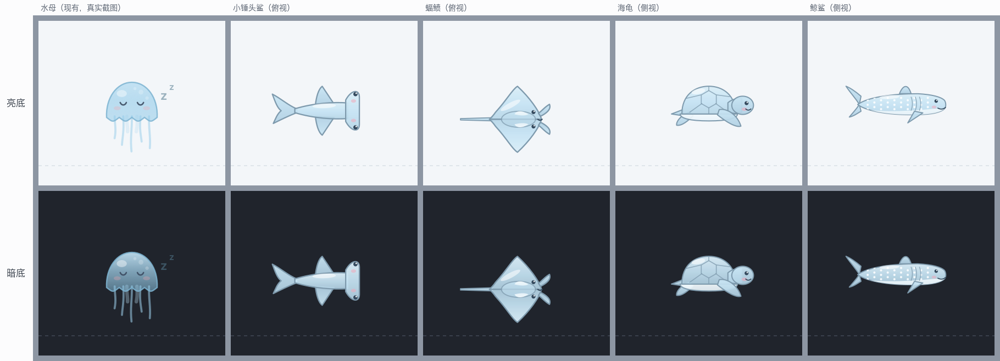
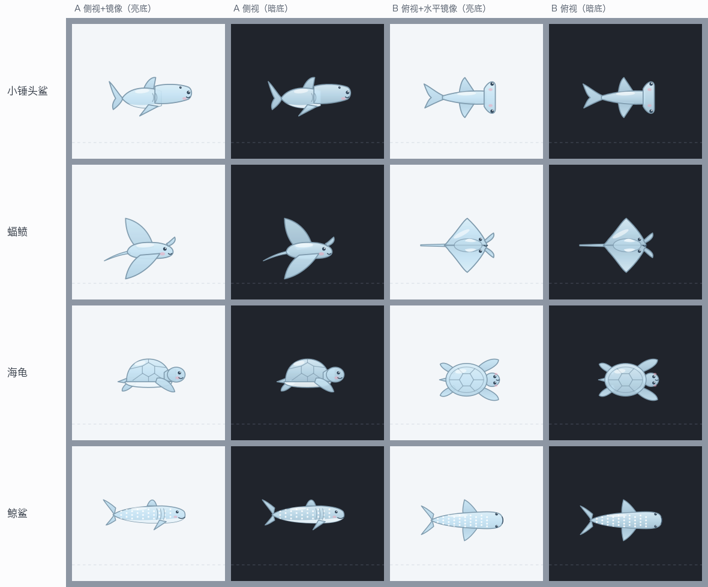
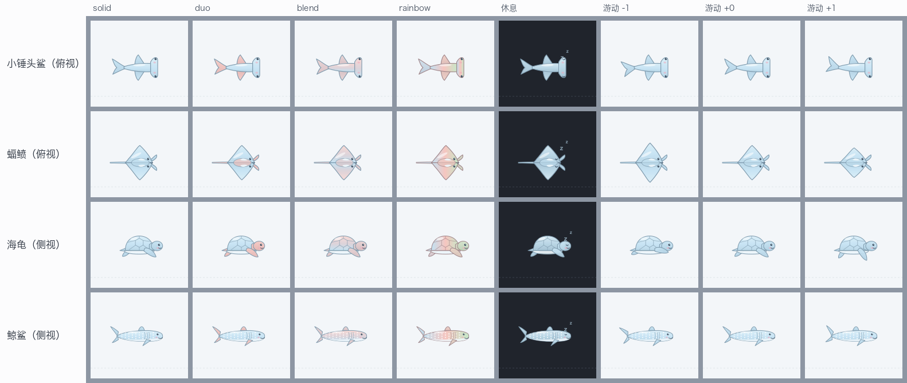

# 桌面动物（物种接口 + 第一批四种）设计稿

日期：2026-10-17　状态：**用户已于 2026-10-17 确认（§11 五条默认值全按推荐），从 Step A 开始实现；Step A（动物接口 + 小锤头鲨）已于 2026-10-18 实现并在隔离环境验证，见 `docs/technical/jelly-species-hammer-20261018.md`（与本设计稿的差异也记在那里），Step B/C/D（蝠鲼、海龟、鲸鲨）未做。** 这是形象系统设计稿（`2026-10-17-jelly-appearance-design.md`）里的子项目 3；用户已决定的顺序是“补 S1a 欠账 → 物种接口与第一批动物 → 材质”，第一批名单是**小锤头鲨、蝠鲼、海龟、鲸鲨**，方式是**一次一只、在设置里切换**（`switch`）。

## 0. 为什么要做、依据是什么

桌面上目前**只有水母**。用户给的 xlsx（《X 海洋动物创作50帖》）里 28 帖是鲨鱼、22 帖是其他海洋动物（水母只占 4 帖），完整的动物统计与帖子编号见形象设计稿 §9.0。第一批四种动物在表里的依据：

| 动物 | 本文 id | 表里帖子编号 | 说明 |
|---|---|---|---|
| 小锤头鲨 | `hammer` | #2（毛绒锤头鲨）、#12 | 鲨鱼是表里最多的一类（28 帖）；锤头是最容易一眼认出的鲨鱼 |
| 蝠鲼 | `manta` | #1、#45、#47 | 3 帖 |
| 海龟 | `turtle` | #32、#43、#50 | 3 帖 |
| 鲸鲨 | `whaleshark` | #1、#23 | 鲨鱼里体型最大、白点最有辨识度 |

**只借创意，不借代码，也不复制任何画面**：我读了表里的文字（阅读范围见形象设计稿 §9.0），没有播放任何视频；下面的外形是我自己用基本图形画的卡通示意，不是帖子里的作品。id 与并行的“水族馆”分支（首页，Chrome 里的 Canvas）对齐（`hammer`、`manta`、`whaleshark`，另加 `turtle`），两边不共享代码，合并时只需对齐名字。

## 1. 目标与不做

目标：

- 设置里选一种动物，桌面上**只出现这一只**；默认仍是水母，**水母的画面与现在逐像素一致**（用 S1a 的 4 张基线图守住）。
- 动物能做水母现在会做的**所有事**：游动、休息、睡着、看向鼠标、被点一下跳一下、被抓住、倒计时读数与阶段色、响铃（游到屏幕底部正中并弹出气泡）、喝水/起身气泡、夜晚荧光。
- S1a 的 **8 色 × 4 花纹**对每种动物同样有效，规则沿用水母的（§4）。

不做（本轮）：材质（软糖/毛绒/线框/铅笔/像素）、尺寸、节日换装、右键“换一只”；多只同屏（水族馆分支在做）；互动玩法与收集；Chrome 首页背景里的水母皮肤（另一套系统，不动）。**“每天换一只”和“随机一只”只换颜色与花纹，不换动物**——否则选了鲨鱼的人会被“随机一只”悄悄变回水母。

## 2. 四种动物的样子与视角

下面三张图是设计示意：我用 SVG 画的，**真实绘制由 CoreGraphics 完成，抗锯齿与渐变细节会有差别**；颜色用的是 S1a 8 色里实测的冰蓝、红、绿。美术上喜欢不喜欢，只有用户目测才算数，实现后可能要多轮调整。

**与真实水母同比例**（最左一列是真实水母的原生窗口截图，不是画的；170×150 的窗口，2 倍显示）：



水母钟罩宽 46 pt、高 32 pt，含触手 76 pt 高（图里这只睡着，触手短，约 64 pt）；动物长度 80 / 82 / 76 / 92 pt（锤头 / 蝠鲼翼展含尾 / 海龟 / 鲸鲨），高度 46 / 61 / 38 / 34 pt。缩放系数是按实测包围盒反算的，不是估的。

**每种动物我都画了侧视和俯视两种**（左两列侧视、右两列俯视，各自亮/暗底）：



推荐视角（能一眼认出是什么动物的那一种）：

| 动物 | 视角 | 理由 |
|---|---|---|
| 小锤头鲨 | 俯视 | 侧视只看到一条鱼；俯视才看得出横向的“锤” |
| 蝠鲼 | 俯视 | 侧视是一条细扁的东西；俯视的菱形翼展与长尾才是蝠鲼 |
| 海龟 | 侧视 | 龟壳穹顶 + 鳍状肢最像；俯视像一只盘子 |
| 鲸鲨 | 侧视 | 长身与白点在侧视最清楚；俯视和普通鲨鱼差不多 |

视角是物种数据里的一个字段，**想改某一种只需换一份几何数据，不增加代码复杂度**。

**花纹、休息、游动三帧**（推荐视角；游动 −1/0/+1 是拍尾/扇翼/划水的相位）：



## 3. 物种接口（部件式）

**为什么是部件式**：水母的画法（`JellyPainter` 的 `tentacles/bell/face`，参数是钟罩的 `cx/by/w/h`）和游动物理（`jelly-swim.swift`，靠钟罩收缩推进）都是水母专用。如果每个材质都为每种动物各写一遍画法，5 种材质 × 5 种动物就是 25 份。所以动物只产出**形状（路径）和角色**，材质只决定**怎么画这些形状**——后面做材质时（像素对任意形状做离屏栅格化、线框与铅笔描边、毛绒沿轮廓加绒、软糖与玻璃填充加高光）一份实现覆盖所有动物。

接口草案（计划阶段细化名字与签名）：

```swift
enum JellySpeciesID: String { case jelly, hammer, manta, turtle, whaleshark }   // 未知值 → .jelly

enum SpeciesRole { case body, limb, belly, accent, shine, eye, blush, mouth }    // 材质只认角色

struct SpeciesPart {
    var role: SpeciesRole
    var path: CGPath                       // 身体坐标，原点在包围盒水平中心
    var z: Int
    var motion: PartMotion?                // 枢轴 + 最大摆角 + 相位偏移（拍尾、扇翼、划水）
    var limbPosition: CGFloat?             // 肢体在身体上的位置，尾 0 → 头 1，七彩取色用
}

struct SpeciesGeometry {                   // 纯数据，来自生成的数据表
    var id: JellySpeciesID
    var view: SpeciesView                  // .side | .top
    var parts: [SpeciesPart]
    var eyes: [CGPoint]; var eyeRadius: CGFloat
    var bounds: SpeciesBounds              // 左/右/上/下延伸，窗口内的标准位置由它算出
}
```

- **水母本身不迁入部件接口**：它保留现有的过程式画法（触手随时间摆动），保证 4 张像素基线不变。材质阶段再评估把水母也迁进来（迁移就以那 4 张图为闸门）。`JellyView.draw` 里 `species == .jelly` 走原路径，其余走新渲染器。
- **几何数据只有一个来源**：形状写成 SVG 路径串（只用 `M/L/C/Q/Z` 绝对命令）放在 `js/jelly-species-shapes.js`（设置页预览要画它）；原生端的 Swift 数据表由 `desktop-reminder/gen-species.mjs` 生成并入库，测试检查“生成物与数据一致”，另有一个只认上述命令的小解析器（自测与 JS 对拍）。这样想改一只动物的外形只改一处。**退路**：若解析器与生成器的复杂度超出预期，预览改用 4 张静态缩略图（不随颜色变），原生几何手写在 Swift 里。
- **草图原点是身体中心，包围盒并不对称**（小锤头鲨俯视左 54 / 右 37 pt）。数据生成时按包围盒水平中心平移，使“转身镜像”不让身体跳动。

## 4. 颜色与花纹如何套到动物上

沿用 `JellyPaint` 的三个色位 a/b/c 与既有规则，**不新增颜色，也不改 JS 与 Swift 现有的数值**：

| 角色 | 规则 |
|---|---|
| `body`（身体、龟壳、蝠鲼的菱形身体） | 纯色/双色：主色 a 的三段渐变（下深上浅）；渐变：下缘 a → 顶部 b；七彩：沿**身体轴线从尾到头** a→b→c 铺开，再叠一层自上而下的亮度。与钟罩填充同一套 |
| `limb`（鳍、尾、鳍状肢、头鳍） | 与触手同一规则，但按肢体位置取色：纯色 a；双色 b；渐变 a、b 按 0.7 混合；七彩按 `limbPosition` 在 a→b→c 间取色。触手现有的“按序号取色”改成同一函数 `limbTone(u)`，序号只是 u = i/(n−1) 的特例，水母的数值不变 |
| `accent`（鲸鲨白点、龟壳纹路） | 与口腕同一规则：纯色 a，其余 b，再提亮 |
| `belly`（腹面：龟的腹甲、鲸鲨的白肚皮） | 主色 a 大幅提亮（约 65–80%），不随花纹变 |
| `shine`（高光） | 固定白色半透明 |
| 描边 | 七彩用 b，其余用 a，变深 12%（与钟罩一致） |
| 眼睛、腮红、嘴 | 固定颜色，与水母的脸一致，不随调色板变 |

阶段色（临近/紧迫/最后 10 秒/到点）**覆盖**所选颜色、夜晚推色，都走水母现在的同一条路径（`JellyPaint.target`、`mixed`、`mixedAll`），动物无需另写。

七彩“从尾到头”是镜像安全的：转身后颜色跟着身体走，不是跟着屏幕。上图的七彩即按此规则画。

## 5. 在窗口里怎么放（锚点）

窗口仍是 170×150（带气泡时按现有规则放大）。现有水母的几个关键数字，动物要与它们兼容：

| 量 | 现值 | 动物的处理 |
|---|---|---|
| 休息时触手底端离窗口底边 | 18 pt（`JellyCompanion.tentacleReach`；窗口放在 `laneY + swim.y − 18`，所以休息时触手正好落在泳线上） | 窗口位置规则**不变**；动物在窗口里的画法不依赖它 |
| 钟罩顶 / 气泡尾尖 | 94 pt / 99 pt（离窗口底边） | **身体顶端统一放在 91 pt**，所以不论哪种动物，响铃气泡的尾巴与身体顶端的距离都和水母同一量级；上图即按这个规则摆放 |
| 光晕半径 | `CountdownModel.glowRadius`（按窗口几何，外圈留 8 pt） | 圆心取身体包围盒中心，**沿用同一函数**，边缘处衰减为 0 的验收口径不变 |
| 响铃涟漪外圈 / 圆心高度 | 62 pt / 约 76 pt | 圆心取身体中心（约 60–74 pt）；外圈取 `min(62, 圆心到最近窗口边 − 8)`，蝠鲼约 52。验收口径“窗口最外 8 pt alpha ≤ 1”不变 |
| 睡眠 z 标记 | 钟罩右上 | 身体包围盒右上 |
| 读屏标签 / 面板标题 / 右键“收起…” | “桌面水母” / “收起水母” | 原生端有 id→名字表：“桌面蝠鲼”“收起蝠鲼”……（水母不变） |

动物**悬停**在这个标准位置，而不是趴在泳线上：趴下会让气泡尾巴离身体 20–47 pt（尾巴指着空处），涟漪外圈也会被窗口底边截掉。代价是休息时动物比趴下时离屏幕底部多约 12–39 pt（蝠鲼 12、锤头鲨 27、海龟 35、鲸鲨 39），可以在真机上看了再调。

## 6. 游动与动作

- **复用现有物理**：`JellySwim` 的冲量模型（每次“脉动”给一次冲量、阶段越紧迫周期越短）、休息/游动/被抓三种模式、冲刺、戳一下都不变。动物的“脉动”就是它们的一次划水：拍尾、扇翼、划鳍，节奏取自 `contraction`（0…1），画成 `(contraction − 0.5) × 2` 的相位，与推力同步。
- **每种动物自己的参数**：`JellyTuning`（`period / thrustX / thrustY / hover`）按物种乘系数。鲨鱼与鲸鲨水平冲量大、竖直小、周期慢；蝠鲼最慢、滑行最远；海龟慢而稳。`JellySwim` 里写死的下沉与阻力常量（`sink / dragX / dragY`）搬进调参结构，**默认值等于现在的数，水母不变**。数值先定初值，用模拟与真机目测校准。
- **竖直分布**：水母曾一路游到屏幕顶端（推力固定、上升快于下沉）。现有自测 `companion-selftest.swift` 的“游动：纵向分布”对每个阶段要求平均高度接近愿意停留的高度，**每种动物 × 每个阶段都要过同一道检查**。
- **朝向与转身**（数值是初值，真机校准）：`facing = sign(vx)`，速度小于 12 pt/s 不翻面；翻面用 0.3 秒的横向缩放过渡；“减少动态效果”下瞬间翻面。身体按速度方向微倾：`pitch = clamp(atan2(vy, max(|vx|, 30)), ±0.35)`。
- **表情**：睡着闭眼（弧线）、眨眼、眼睛跟着鼠标走（偏移不超过 1 pt）；侧视动物有微笑与腮红，**俯视动物看不见嘴**，所以“警觉”表现为眼睛放大 1.3 倍，“被抓”同样。

## 7. 设置、协议与能力探测

- **存储**：`desktopJellyAppearanceV1` 增加 `species`（`jelly|hammer|manta|turtle|whaleshark`，默认 `jelly`，未知值回 `jelly`）。`js/jelly-appearance.js` 的 `normalize/resolve` 带上它；`daily` 与 `reroll` **不改它**。
- **设置页**：“桌面水母形象”卡片新增“动物”一行（5 个选项带缩略图）。颜色与花纹的示意图改画**当前选中的动物**（数据来自 §3 的同一份几何）。文案如实写“同一时刻一只；颜色与花纹对所有动物有效；材质与尺寸会在后续版本加入”，示意图只是静态示意，不是实时预览。
- **协议仍是 v7**。`jelly` 命令的 `appearance` 载荷增加可选字符串 `species`；原生按白名单解析，缺省或未知 → `jelly`。**回执 `appearance` 增加 `species`，值是实际生效的那一个**：Chrome 把它与请求的比较，不一致（旧组件认识外观却不认识动物）就提示“请更新组件”，**不声称已应用**——这比只回 `ok` 严格，因为中间版本的组件会安静地画回水母。ping 新增 `jellySpecies`。
- **JS 与 Swift 各有一份**：id 列表与默认值、`limbTone` 数值，`test/desktop-companion-logic.test.mjs` 逐项对照（沿用 S1a 的 PAINT 行方式，改一边必须改另一边）。
- **安全与权限**：不新增权限、网络或连接；`species` 是两端各自白名单的枚举，设置消息沿用 `sender.id`/`sender.url` 校验；几何数据是静态常量，没有 `eval`，原生路径解析器遇到非 `M/L/C/Q/Z` 命令或非数字直接拒绝。

## 8. 验收方案（沿用 S1a 的做法并扩展）

| 层级 | 内容 |
|---|---|
| 静态 | `git diff --check`、`node --check`；Swift 随构建与自测一起编译 |
| Chrome 侧业务替身 | `species` 的解析、默认、未知值、`daily/reroll` 不改动物；`JellyDesktop` 下发与“请更新组件”判定；设置页对各种后台响应的处理；源码绊线（无网络、无 `innerHTML`、无新调度） |
| Swift 纯逻辑自测 | 数据表：每种动物 × 每个相位（−1…+1）× 朝向：包围盒在窗口内且离边 ≥ 8 pt、顶端 = 91 ± 1、水平居中 ± 1、镜像后包围盒镜像一致；路径非空且闭合；解析器对拍与拒绝畸形输入；调参：每种动物 × 每个阶段的纵向分布；涟漪外圈几何；id 解析 |
| 语义渲染检查 | 扩展 S1a 的 `appearance-looks.mjs`：钟罩/触手靠“行宽 40%”分区的办法不适用于鲨鱼和蝠鲼，所以对每种动物改用**采样点法**——采样点（身体头/中/尾、各肢体、轮廓）随几何数据一起定义，由检查脚本按放置规则换算成截图像素，取小窗中位色，与同一位置在纯色截图里的各色位参照色比色差；七彩从尾到头、肢体按位置取色、轮廓取 b 等都逐条断言。**这是新办法，实现时要先用纯合成图像验证它自己**，并做变异检查 |
| 水母回归 | 4 张像素基线逐像素一致（显式默认与不下发两种情况） |
| 原生冒烟（独立 Bundle ID） | 扩展 `appearance-smoke.mjs`：下发每种动物 → 回执 `species` 回显；缺省/未知回水母；阶段色覆盖动物；响铃时气泡尾巴不遮挡身体；`jelly-smoke --no-mouse`、`bridge-smoke` 全通过 |
| 性能 | 沿用 S1a 的离屏计时（`JellyView.cacheDisplay`，基线 0.219 ms/帧），每种动物 × 4 花纹对比；**上限参照是 S1a 实测的水母七彩（白天比纯色多 25.6%，约 +0.056 ms/帧）**，超过它再决定是否缓存静态部件 |
| 变异检查 | JS 解析、Swift 纯逻辑、AppKit 绘制与锚点三层，只改 `/tmp` 镜像副本，跑完核对仓库文件哈希；存活者逐个归类（等价 / 不可观测 / 真缺口） |

## 9. 分期

计划阶段会细化成可执行的步骤，大致是：

- **Step A（接口 + 第一种动物）**：`limbTone` 重构（水母数值不变）→ `species` 字段与协议回执 → 几何数据 + 生成器 + 解析器 → 渲染器与放置规则 → 游动参数拆分 → 设置页 → **小锤头鲨端到端验证**。
- **Step B / C / D**：蝠鲼、海龟、鲸鲨——各自的几何数据、调参、采样点、冒烟。
- 每一步都以分层验证收尾，变异检查只在 Step A 和 Step D 各做一轮系统的。

## 10. 风险与未验证

- **美术**：草图不是真实绘制，可爱度与辨识度只有用户目测才算数；俯视动物在桌面上“忽左忽右、上下漂”是否自然，要真机看。
- **性能**：未测。鲸鲨有约 60 个白点，其余动物部件少；先测再说。
- **文案**：设置页与提醒里还有“水母”字样——设置页卡片标题“桌面水母”、“右键水母选‘问 AI…’”，以及 Chrome 侧生成的喝水提醒标题“水母口渴了 💧”。**默认让功能名继续叫“桌面水母”**，原生面板标题与读屏用物种名；喝水/起身提醒标题由 `js/jelly-nudge.js` 生成，选了其他动物时会名不符实，需要改成按所选物种取名（小改动，不影响默认用户）。要不要整体改名为“桌面小伙伴”，是产品决定，不在本稿。
- **合并**：水族馆分支也在画 `hammer/manta/whaleshark`（首页 Canvas，与本分支的 Swift 原生不共享代码）；外观 × 差事 × 水族馆的文本冲突见形象设计稿 §11，合并后两边测试都要重跑。
- **未验收**（同 S1a，实现后依然）：真实 Chrome 156、重装后的真实组件与重载扩展（由用户做）、多显示器、全屏 Space、Stage Manager、壁纸叠加观感、VoiceOver。

## 11. 用户确认的点（2026-10-17 已确认：五条全按推荐）

以下按**推荐默认值**写进了本稿，用户已点“通过”，即按它们实现；以后想改哪条直接说：

1. 视角：小锤头鲨与蝠鲼用**俯视**，海龟与鲸鲨用**侧视**（§2）。
2. 位置：动物**悬停在窗口标准高度**，不趴泳线（§5）。
3. 大小：长度约 **76–92 pt**，与水母同量级（§2 同比例图）。
4. “每天换一只/随机一只”**不换动物**（§1）。
5. 文案：功能名仍叫“桌面水母”，原生面板标题/读屏用物种名（§10）。
