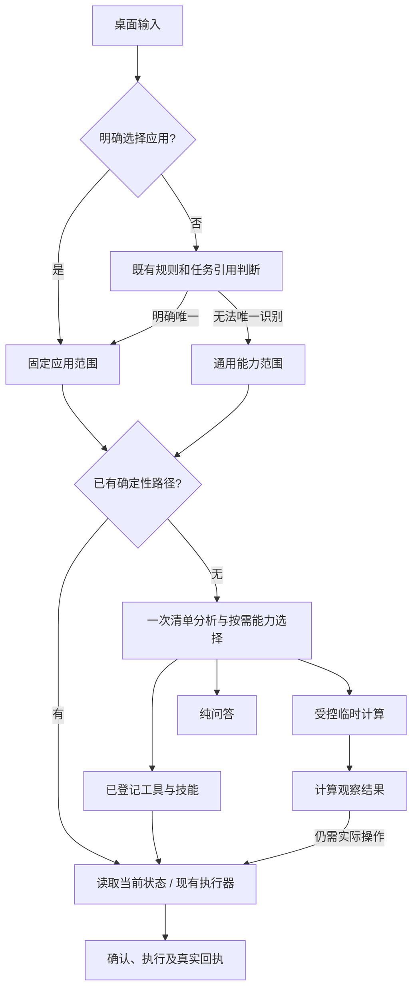

# 桌面 AI 助手：应用补全、意图与执行证据、通用能力及性能

日期：2026-10-21。状态：已按用户授权分阶段实现并完成隔离验收，详见 [实现与验证](../../technical/desktop-assistant-routing-20261021.md)。代码计算保持关闭；未重放真实音乐操作。以下诊断保留当时事实，目标交互与验收范围以实现文档区分已验证和待真实环境验收项。

建设目标：桌面与浏览器共用同一套应用目录、任务与工具执行能力；桌面可以快速选择应用，也可以自动理解或处理通用请求。共享会话保留有用背景，每个新目标的完成都要有对应证据。优化顺序为正确执行、减少无效调用、缩短可编辑等待、提高有效请求的缓存复用。

## 1. 10月21日桌面请求的诊断

本次诊断定位的请求为2026-10-21 10:04:36–10:05:51，原文“随机播放音乐”，`origin: desktop`。同一会话沿用了前一天的音乐流程。三次模型调用如下：

| 阶段 | 耗时 | 模型返回 | 执行器结果 |
| --- | ---: | --- | --- |
| 清单分析 | 32.786秒 | 一项Todo：随机播放当前队列，最终工具 `music.queue.play(mode=shuffle)` | 接受，事项仍pending |
| 执行规划 | 23.394秒 | `{"done":true}` | `ASSISTANT_PLAN_INVALID / todo-incomplete` |
| 有界恢复 | 16.136秒 | 再次 `{"done":true}` | 同一计划错误重复，停止自动恢复 |

本轮没有调用 `music.state`、`music.queue.play`或其他音乐业务工具。不能说本轮已经播放。两次执行阶段的SDK计数为3978/4262，输入预算10576，没有调用 `assistant.compact`。此前分词与压缩修复在这条记录中正常生效。

模型首轮加载18.948秒；三次缓存恢复分别为0、0、2048 tokens，缓存token占比约19.7%。本次应先消除不必要的模型调用，不能靠缓存命中修正错误的完成判断。

直接证据：本机 `local-ai/.local/history.json` 中对应调用编号前缀 `11f24f93`、`6a0cb6e3`、`625f10db`，与LM Studio当日服务日志的正式回复及usage逐条一致。未读取或记录模型内部思考。

### 1.1 已复现的代码原因

- `js/music-intent.js` 的闭合队列播放语法接受“随机播放”，但不接受“随机播放音乐”。后者没有命中快速播放路径。
- `Contract.routeRequest`已正确推断为music，但它没有把这句话识别为独立需求：同样在前轮已完成、无候选的音乐上下文里，“随机播放”得到`new`，“随机播放音乐”得到`continue`。
- `Engine.submit`在continue时复制旧observations。此次执行输入中仍有2026-10-20 17:21的43首队列及播放成功状态，当前轮`completedSteps`却为空。模型两次输出done；旧观察与当前目标混在一起是需要修复的输入结构问题，不能通过放宽Todo完成校验解决。
- 当前context中的回执有各自turnId，但没有显式的当前turnId；observations也没有轮次/历史标记。模型不应承担猜测哪些回执属于本轮的责任。

这些是共享路由/执行链的问题；桌面来源已经正确传到模型。增加原生`@`菜单本身不能替代这部分修复。

### 1.2 为什么共享会话时，大模型重新分析仍然失败

共享会话本身不是错误，也不应要求用户每次手动新建会话。**这次已经调用了大模型重新分析**：清单分析识别出了“随机播放当前队列”，不是因为完全没有识别出音乐需求。失败发生在后续执行规划：模型两次提前报告完成，没有提出查询或播放工具调用。

应把证据与推断分开：

- 已证实：新目标尚未完成，模型输入中却仍有昨日的播放成功观察；模型两次返回`done`，Todo校验均拒绝，本轮没有音乐业务调用。
- 合理推断：缺少历史/当前标记的旧成功观察可能干扰了完成判断。没有读取模型内部思考，不能宣称已经证明其具体推理过程。
- 已有保护：执行器没有把模型的“完成”当成真实播放成功；同类错误重复后停止，避免无限推理与重复副作用。
- 能力缺口：规则未命中后，模型路径缺少清晰的本目标证据边界；恢复反馈没有让流程取得缺失的当前状态。同一句“尚未完成”原样重试仍可能重复失败。

因此不能只补“随机播放音乐”的同义句。修复必须同时覆盖规则命中与未命中两条路线：规则负责明确短指令的低成本执行；一般表达交给模型规划，并由受控工具核验当前事实。也不能机械地多调用所有工具，查询应当对应当前目标缺少的事实。

### 1.3 现有桌面端已经支持的文字语法

原生只提交文字，Chrome再调用同一个 `Contract.input`。因此现在手输以下内容已经能解析：

```text
@音乐 随机播放当前队列
@闹钟 查看已有提醒
@music 随机播放
```

离线检查前两项分别得到music/alarm，保留desktop来源；第一项得到独立请求及既有队列快速播放合同。这里只核对解析，不执行播放。缺少的是原生候选菜单、可见的应用范围和自动/通用模式，而不是另写一个`@`解析器。

2026-10-21补充核对：原生`assistant-panel.swift`的输入变化回调只做输入检查和界面刷新，键盘委托只显式处理Esc；共享`InteractionInput`只接复制、粘贴等快捷键。**目前输入`@`不会弹应用菜单，Tab也不会补全应用**。下文为待开发交互，不能据手输语法可用宣称菜单已完成。

## 2. 目标交互

把用户的“没有影响”“通过的能力”按“未指定应用”“通用能力”理解。

- 默认显示“自动识别”。输入`@`弹出应用菜单，第一期使用当前6类：音乐、闹钟、哔哩哔哩、YouTube、任务、工作日志。指扩展已接入的应用能力，不自动获得任意macOS应用控制权。
- 支持中文名、应用ID和既有别名的本地筛选；`↑↓`选择，Tab或Enter选中候选，只补全应用，不提交请求。输入法组字期间不截获确认键。Esc先关闭菜单，再收起面板。
- 选择后显示可移除的应用标签，提交仍将它序列化为既有的前置`@appId`文字，交给Chrome统一解析。尽量不扩充原生可提交的权限字段。
- `/`展示当前应用兼容的已登记动作。实际模型技能提示来自本项目 `local-ai/skills/`，不自动加载用户全局插件、Codex技能目录或模型生成的扩展文件。
- 应用/动作目录由Chrome从 `AssistantContract.apps/skills`投影为有界纯文本目录，附修订号；Swift不维护第二份能力清单。通过现有Native Messaging连接按能力回执探测下发；旧组件保持文字输入，不因菜单不可用而失去原功能。
- 自动推断后显示“音乐 · 自动识别”；无法唯一确定时显示“通用”。推断和用户明确选择必须可区分，模型不能把自己的判断标为用户授权。
- 增加显式“新需求”入口。单纯的taskId/version只证明面板看到了哪个状态，不能单独证明新输入是在继续该任务。

### 2.1 `@`、Tab和输入法的具体行为

第一期沿用`Contract.input`只解析前置命令的语法。只有光标位于可解析的前置`@`/`/`命令片段时才触发菜单；正文中的邮箱、URL和引用文字不触发，不顺便扩大为任意位置多应用提及。

| 输入或按键 | 目标行为 |
| --- | --- |
| 输入`@` | 立即显示已接入应用，默认高亮首项；没有目录时显示轻量状态，文字仍可编辑 |
| 输入`@音`或`@mus` | 本地匹配中文名、ID与既有别名；精确匹配优先，排序稳定，不调用模型 |
| `↑↓` | 在候选中移动，保持光标/输入内容；不操作后台任务 |
| 候选打开时按Tab | 选中高亮项，替换当前命令片段并补空格；焦点留在输入框，不发送 |
| 候选打开时按Enter | 只选择候选；随后输入需求，菜单关闭后再次Enter才沿原路径提交 |
| 无匹配项时按Tab/Enter | 不猜测应用，不发送半截命令；提示无匹配并保留原输入 |
| 菜单关闭时按Tab/Shift+Tab | 保留系统焦点导航，不把普通Tab全局劫持为补全 |
| 菜单打开时按Esc | 只关闭菜单；再次Esc才收起面板 |
| 中文输入法仍有组字 | 先由输入法处理选词/确认；组字结束后再刷新候选，不能误提交 |
| 删除应用标签或撤销输入 | 恢复为自动识别，保留需求正文；撤销/重做和粘贴不丢文字 |

演示流程：输入`@音` → Tab得到`@音乐 `（或等价应用标签）→ 输入“随机播放当前队列” → Enter提交。Tab本身不会调用模型、创建Todo或播放音乐。菜单提供可访问名称、当前选中状态和必要的键盘提示。

### 2.2 目录同步与界面就绪

复用现有Native Messaging连接，由Chrome下发目录修订号及有界的`id/name/aliases/description`等展示字段。原生只保留当前连接的只读展示副本，按目录变化更新；不逐键请求Chrome，不维护第二份工具注册表。菜单加载失败保留手输路径，恢复连接后重新同步。

应用目录可以缓存，授权不能随之缓存。提交时仍由Chrome按当前注册目录、工具范围和策略校验；旧目录中的已移除项不得执行。过期更新不得覆盖新目录，迟到目录不得改写用户已输入文字或自动选择应用。目录内容仅作纯文本展示，不携带可执行代码。

原生面板先显示并允许输入，目录、任务快照与模型状态异步到达；沿用任务就绪及版本校验，允许输入不等于允许提前执行。连接暂不可用且面板仍存在时保留文字并说明状态，不把输入当作已提交。现有原生进程随Chrome连接结束而退出，本期不承诺跨进程草稿恢复、不另建原生持久化状态。浏览器已有的“先可编辑、后恢复草稿”及bundle构建方案继续保留，不因加入菜单重新串行等待初始化。

“新需求”入口需在原生消息白名单中显式接入已有`newConversation`布尔语义，由Chrome校验并路由；不能仅靠清空输入框或省略taskId模拟。继续保留当前任务/版本绑定与运行中任务互斥，不能借此取消正在执行的任务、清除相关unknown或扩大应用权限。旧组件不传新字段时仍可提交文字。

## 3. 统一路由与能力选择



优先级：用户明确`@` > 当前明确引用/确认答复 > 可确定的现有规则 > 清单分析时选择能力 > 通用答复或临时计算。不要额外固定增加一轮“分类模型”；可复用的本地路径直接走，剩余分类并入已有outline。

“继续”“第2个”等仍绑定当前候选、任务版本与有效期。完整的新操作不能因上一个应用恰好也是music就沿用昨日播放器状态。一般知识问答也不能因为上一项是音乐而自动留在music里；离线复现“帮我分析这组数字”目前仍会继承music，此行为应在通用模式加入时修正。

自动识别有多个可能目标、或动作对象不明确时才澄清；不能把模型自报的置信度当作授权。明确`@应用`后，不静默扩大到其他应用。

自动识别第一期依据用户输入、有效交互引用和已登记能力；不为猜应用持续扫描前台窗口、屏幕或用户文件。当前前台应用即使以后作为上下文接入，也只能是有来源的线索，不能覆盖明确的`@应用`或赋予操作权限。

### 3.1 历史与本轮状态

- 保留同一会话的用户限制、历史证据与未解决unknown，继续使用现有Context/pi摘要。不要删除全部历史来回避问题。
- 新意图开始时，旧业务状态归为历史背景，当前observations只承载本目标有效的查询与回执；跨轮需要的候选通过显式引用及现有有效期继承。
- 在模型输入中增加执行器生成的当前turnId和回执来源标记，区别“当前目标已完成”“历史曾完成”“结果未知”。字段白名单和长度由服务端校验，回执有效性最终由持有任务和工具结果的Engine判定；格式合法的turnId本身不证明授权或成功。
- 此次新播放目标须先取得当前 `music.state` 与真实revision；完成由新目标对应的真实播放回执驱动。模型再次过早done时，反馈指出缺失的回执，不接受昨日done。
- 状态、路由和来源等易变内容放在模型输入/系统提示后部；不插入已验证的静态前缀。

需要区分三个概念，不能仅凭“相同会话”或“不同turnId”决定能否复用：

| 概念 | 负责什么 | 复用规则 |
| --- | --- | --- |
| 会话背景 | 用户明确限制、解释、历史经历 | 可按来源保留；历史事实不证明当前资源状态 |
| 当前目标及Todo | 用户现在要完成什么、哪些步骤已完成 | 新的独立操作建立新目标；选择/澄清沿既有绑定继续目标，不重复已完成动作 |
| 执行轮与资源状态 | 本次查询/写入的结果、资源版本、有效期 | 使用工具规定的时效与版本；确认后资源改变须重新校验 |

优先扩展现有task/turn/Todo和Context记录的投影，不建立平行会话库或另一套摘要引擎。拟补充当前轮标识、回执来源轮、关联Todo/来源引用、采集时间与资源revision；能从现有记录推导的字段不重复持久化。旧快照缺少来源时标记历史或未知来源，不自动认定为当前成功。

选择/澄清可能形成新的turnId，但仍属于同一未完成目标。因此不能把所有`receipt.turnId !== currentTurnId`的回执一律丢弃：已完成Todo保持完成，候选仍按原有效期校验；资源状态是否要重读由版本、失效事件及工具合同决定。新目标也不能通过切换会话绕过仍与同一资源相关的unknown；这类限制针对可能重复的关联动作，不把无关的通用问答一并阻塞。

### 3.2 状态核验与有界恢复

目标流程为：理解新请求 → 建立或延续目标 → 检查所需当前事实 → 按需查询工具 → 生成可执行参数 → 必要确认 → 执行 → 依据真实回执推进Todo。模型负责理解和规划，执行器负责版本、授权和完成判定。

1. **缺少当前事实时先查询。** 为已登记动作明确其只读前置条件和结果要求，先覆盖音乐队列等已有场景。复用当前“缺少可信revision则投影为`music.state`”能力，不能采用任务`context.revision`或昨日revision补参数。不为已有有效状态重复读取，也不能用固定TTL代替执行时的资源版本检查。
2. **过早done给出可执行反馈。** 错误仍为`todo-incomplete`，附当前未完成项、缺失证据类别和该应用已登记的查询工具；例如“当前播放目标没有有效状态及播放回执，请先查询music.state”。只读查询成功并不等于播放目标完成。
3. **受控补查有严格条件。** 仅当受校验Todo已明确目标、工具前置关系唯一、参数可从可信引用得到且当前范围允许时，才把一次缺证据恢复投影为注册的只读查询，交给原Engine调度；本例可查`music.state`，无需为这类已授权的只读核验再问一次用户。记录投影原因，计入工具/时间预算，不偷偷在规划服务内部执行工具。它是与反馈重规划择一的恢复分支，不叠加额外循环。
4. **没有明确补查路径就重新规划或澄清。** 禁止根据模型任意文本选择工具、补写参数或直接播放；涉及unknown只能按既有规则查证，查到“正在播放”也不能冒充本次写操作已成功。查证不足时保留未知态和人工核对入口。
5. **恢复必须产生新信息。** 复用既有每执行轮最多3次恢复、同类错误重复停止及12轮/12工具/5分钟预算；不重置计数、不延长任务时限。补查成功后才基于新观察继续，不能拿旧回执换个字段名当作恢复进展。

没有匹配到短句规则，也应能走完上述模型路径；验收要专门关闭/绕过快速路径做同样的隔离场景。保留Todo对`done`的拒绝，不用放宽完成判断换取表面成功。

### 3.3 能力发现与通用回答合同

“有工具用工具、有技能用技能”落实为按需发现与组合：技能提供工作方法，工具提供受控执行；二者并不互斥。简单需求已有确定性工具链时直接复用，复杂需求在已有outline内选范围和已登记技能，随后通过`tools.load`按需加载工具组。没有匹配应用不应被旧music范围锁住，也不等于必须写代码。

第一期通用模式不开放任意跨应用写流程。明确一个已接入应用后按该范围执行；多个应用组合若尚无受控合同，说明缺口或澄清本次目标，不能默默扩大范围。

当前规划协议以工具Todo为主，不能把普通答案塞进question后假装任务已完成。为纯问答设计单独的受控回答结果/目标类型：调用Gateway、计费、取消与超时均保留；结果只表示“已回答”，不证明播放、保存或任何外部动作。

只有纯知识解释、改写等无外部动作的请求走直接回答。包含“读取我的文件”“发消息”“修改任务”的输入必须落到实际能力与授权，不允许用一段文本冒充执行。

扩展回答合同应同时覆盖服务端结构校验、Engine终态、历史记录、浏览器/原生展示和取消后的迟到结果；明确区分答复、待澄清、等待确认、动作完成。无工具可获取实时信息时说明缺少来源，不用模型常识冒充当前应用数据。

## 4. 模型临时写代码的落点

本机已具备 `compute.run`，本次诊断时控制策略中 `computeEnabled=false`，开发与验收前须重新读取实际策略。它是可复用的临时纯计算入口，不需要另造动态工具引擎。

执行顺序为：已登记工具取数据 → 模型生成短代码 → 现有QuickJS-WASM隔离子进程执行 → 返回JSON观察 → 如需动作，再由原工具执行器处理。

例子：读取音乐队列后分组/计算总时长；读取提醒后计算间隔；纯数字或日期运算。已登记工具能直接给答案时不调用计算，例如队列已有count就直接使用它。

继续采用当前约束：默认关闭，遵守模型总开关与场景开关；无网络、无文件、无宿主对象；2秒、16MiB逻辑内存与64MiB WASM硬顶、栈256KiB、16KiB输出、同时2个；只读既有inputRefs（最多6个、合计40KB），原有恢复及12轮/12工具/5分钟预算不变。生成代码和数据正文不进入运行日志，不持久化生成工具，不把摘要或计算输出当作授权。沙箱不可用时明确拒绝，不退回主进程执行。

**没有现成工具且需求涉及新的I/O时，不能把“没有工具”视为任意执行代码的授权。** 当前项目明确不允许代码直接调用业务工具或持久化自写工具。若下一阶段希望临时代码读写文件、联网、操作系统，需要单独设计能力清单、隔离执行环境、授权资源引用、确认与结果审计；这部分需人工安全评审，不属于本草案第一期。pi的 `registerTool()`只是工具登记API，不能替代沙箱；本项目继续使用其已接入的库级能力，不启用全局扩展、bash/write或独立AgentSession来绕过现有执行器。

## 5. 必须一并核对的桌面确认边界

项目规范要求桌面写操作保留确认。现有实现中的desktop判断位于“已有review结果、且动作是alarm.create/alarm.commit”的自动确认适配层；`music.queue.play`、`task.create`、`worklog.create`目前各有直接调用依赖/存储的路径。因此该判断不能被当作“所有写操作已经统一确认”的证明。这不是最新失败的原因，但扩大能力前需要补齐。

按工具的真实副作用登记read/prepare/write分类；桌面写入先产生由实际参数投影的确认卡，之后经已有 `Engine.respond/choose` 提交。确认前不得调用业务写依赖；确认卡绑定taskId/version、参数指纹和资源revision，过期、取消、unknown仍由现有路径处理。技能、自动应用识别和计算代码均不能绕过此门。若产品以后允许某类低风险桌面动作免确认，应作为明确的策略调整另行决定。

确认必须覆盖快速路径、模型规划、恢复投影后的后续动作和候选直接选择，不只覆盖某一个规划入口。已有准备/确认卡的工具复用原卡，避免重复确认；没有准备阶段的写工具在执行器的统一门禁前投影实际参数。提交时再核对版本和策略，参数或资源变更使旧确认失效；写依赖开始前保留`sideEffectStarted`及原幂等/unknown语义。

## 6. 缓存、响应速度与电脑消耗

缓存分层处理；界面目录缓存、模型前缀缓存与业务状态不是同一种东西。

| 层次 | 允许复用的内容 | 失效与边界 |
| --- | --- | --- |
| 原生界面 | 当前连接的应用/动作目录、筛选索引 | 目录修订/连接变化更新；仅展示，不证明当前权限 |
| 浏览器初始化 | 已有本地bundle；相同读取的在途请求 | 继续合并重叠读取，完成后读取最新策略与快照；不缓存授权结论 |
| 模型输入 | 真正稳定的规则前缀、稳定排序的能力描述 | 动态状态/目录差异放后部；模型、模板、思考档位与装载状态分组分析 |
| 分词与上下文 | 当前请求指纹一致时的计数；pi管理的有来源历史摘要 | 输入/思考/容量变化重新计量；不以粗估替代已加载模型的正式计数 |
| 业务事实 | 当前目标内仍有效的查询结果及受控候选引用 | 新目标、资源变更、版本失效后重新核验；禁止缓存动作成功来回答新动作 |

### 6.1 优化顺序与成本约束

1. `@`菜单、Tab筛选与确定性短指令均不需要模型；目录同步只在连接/修订变化时发生，不新增持续轮询或模型预热。
2. 修复过早done造成的无效重试；符合闭合语义的队列短指令复用本地查询与执行链。存在歌手、曲风、否定、条件、候选引用或多动作时交给完整规划，不能为少调用一次模型而丢约束。
3. 应用识别与技能选择并入既有outline，避免强制增加一个分类模型请求；工具目录按需曝光，不每轮塞入全部工具或全局技能正文。
4. 保留现有静态前缀顺序，新增加的当前轮、目录修订、动态状态和恢复说明放后部；固定列表排序，避免无意义的序列化变化。不为凑缓存边界增加无用规则。现有2048-token检查点是本机实验观察，不当作所有版本通用保证。
5. 去重和字段投影应减少无用历史正文，保留目标约束、必要回执、unknown、资源引用与版本；继续执行短来源跳过摘要、无收益摘要不覆盖检查点。不能一边混入无关旧状态，一边为压缩它追加模型调用。
6. 不为提高命中率强制模型常驻、扩大缓存容量或改变用户模型/思考策略。缓存可能占内存和磁盘；减少新算tokens是计算量代理指标，不等于已经测得整机省电。

### 6.2 指标与验收口径

只用LM Studio实际`Prompt cache restore`计数计算命中；沿用`local-ai/inspect-prompt-cache.mjs`，缺失计数记未知。本文约19.7%仅描述上述三次失败流程，既不是整机长期水平，也不是新方案的收益。

| 指标 | 记录方式与目标 |
| --- | --- |
| 可编辑延迟 | 从唤出到输入框可输入，分原生/浏览器、冷/热启动统计p50/p95；目录或服务慢不能阻塞输入 |
| `@`候选延迟 | 目录已就绪时从按键到绘制，建议目标p95≤50ms；是待测目标，不是当前实测结果；模型调用为0 |
| 端到端任务耗时 | 拆分加载、分词、规划、工具、等待用户确认；总耗时与扣除用户等待的处理耗时分别报告 |
| 正确性 | 任务完成率、无效计划率、过早done次数、重复副作用次数；验收用例中历史误验收和重复写入均为0 |
| 调用成本 | 每个成功目标的模型调用数、新算tokens、工具次数、无收益摘要数；明确队列快速路径模型调用为0 |
| 请求命中率 | 有缓存的生成请求数 / 有完整计数的生成请求数，列出样本数；无模型调用记不适用，不记100% |
| token复用率 | 缓存tokens /（缓存tokens + 新算tokens）；按outline、执行规划、摘要及业务场景分别统计 |
| 机器资源 | 在相同工作负载记录进程CPU时间、峰值内存、磁盘/缓存占用及采样方法；无功耗数据时不报告节电比例 |

对照需固定模型、思考策略、任务内容和应用场景，将冷加载与热请求分组，交错运行隔离样本并报告次数与范围。缓存改善必须同时检查无效计划和完成质量；不能用更长提示或更多重试换取更高命中率。至少覆盖规则快速路径、模型音乐流程及通用问答；真实使用样本与替身重放分开。没有相应样本时标记未验证。

指标复用现有诊断链路，仅记录有界的请求标识、阶段、计数、耗时与错误类别；不为分析命中额外持久化提示正文、用户输入、临时代码或窗口内容。请求与日志无法可靠对应时保留未知，不用时间接近强行归因。

## 7. 分阶段落地与验收

| 优先级 | 工作 | 关键验收 |
| --- | --- | --- |
| P0 | 修复“随机播放音乐”及等价短句的闭合语法；新意图与历史观察分离 | 昨日任务完成后再次请求：先读当前队列、不复用昨日revision、不把昨日回执验收为本轮完成；必要确认前0写入，确认后播放最多1次；符合短指令条件时不调用模型 |
| P0 | 缺事实补查、过早done反馈与受控恢复 | 未命中快速规则仍能基于新工具回执继续；只读查询不勾选播放目标；重复错误有界停止；不得重复已完成动作 |
| P0 | 核对并统一桌面写入确认 | 覆盖提醒、任务、日志和音乐；桌面来源不能自动跳过要求的确认；未确认/取消/过期时0写入 |
| P1 | 原生`@`/`/`候选、Tab补全、显式新需求、范围提示 | 目录与Chrome一致；Tab/Enter选择不提交；中文/别名/输入法/无匹配/键盘操作正确；离线、旧组件、目录变化保留输入；不新增第二份任务状态 |
| P2 | 通用模式、一次outline内能力选择、直接回答合同 | 音乐任务之后问通用问题不继承music；无关请求不带旧实时状态；不额外增加必需分类轮次；用户已回答的歧义不重复询问 |
| P2 | 现有临时计算在桌面流程中的接线与展示 | 开关关闭时不曝光工具；数据来自真实回执；失败有界恢复；计算不当作业务完成；实际动作仍走确认和回执 |
| 贯穿各阶段 | 输入就绪、前缀缓存与资源回归 | 不新增阻塞初始化/逐键模型请求；前缀测试通过；按第6节报告同场景调用、新算tokens和资源数据 |

先完成P0的证据与确认边界，再扩充原生菜单和通用入口。每阶段独立验收和回滚，协议采取能力探测与旧组件兼容；回滚界面功能不能恢复不安全的历史完成判定或绕过确认。

### 7.1 复用点与最小修改范围

| 能力 | 既有落点 | 拟修改职责 |
| --- | --- | --- |
| 意图与应用路由 | `js/music-intent.js`、`js/assistant-contract.js` | 补闭合语法，区分独立目标/引用延续/自动或显式范围，不另造分类引擎 |
| 历史与完成证据 | `js/assistant-engine.js`、`js/assistant-context-state.js`、`js/assistant-todo.js` | 原状态内补来源与投影、保持合法延续和完成谓词，处理旧快照 |
| 模型与恢复 | `local-ai/assistant-service.mjs`、`js/assistant-tools.js`及现有Gateway | 校验新增上下文、提供缺证据反馈、受控补查及回答合同；不增加第二套执行循环 |
| 原生输入与目录 | `js/assistant-native.js`、现有AlarmDesktop连接、`desktop-reminder/assistant-panel.swift` | 目录投影、能力探测、候选显示和按键；原生不拥有业务状态或执行权限 |
| 确认 | `js/assistant-confirmation.js`、Engine与Tools、原生确认卡 | 统一写前门禁，复用现有交互/回执，不重复弹卡 |
| 历史摘要与计算 | 现有pi适配、`local-ai/compute-provider.mjs` | 保留已锁定SDK、公开API和沙箱；只补受控调用与展示 |

本设计未引入新依赖或升级SDK。当前已锁定pi 0.85.1、LM Studio SDK 2.1.0和QuickJS 0.32.0；按现有公开接口与职责复用，不复制上游引擎、不启用全局插件。若实施发现公开能力不足，先记录具体限制再决定最小适配；不能把本文当作新依赖的发布版本、许可证或兼容性审核证明。

### 7.2 关键场景验收矩阵

| 场景 | 必须观察到的行为 |
| --- | --- |
| 昨日已播放，今天再次“随机播放音乐” | 新目标；先查询当前队列；旧成功回执不验收新目标；写入经确认，成功后只执行一次 |
| 同一需求不走短句规则 | 模型路径取得新状态并完成，不能连续空done后把失败当成功 |
| 多步骤中用户选择“第2个”或补充答案 | 延续原目标与有效候选；保留已完成项，不重做前序动作 |
| 当前队列为空/过期/格式异常 | 按真实状态与已有队列恢复合同处理；不得凭昨日43首直接播放、清空或另找歌曲 |
| 查询后队列被其他入口修改 | revision检查阻止旧参数；重新核验与必要确认，不能继续用旧确认 |
| 写入可能生效但回执丢失 | unknown保留，只做受控查证；新请求/新会话也不能触发自动重放 |
| `@音`后Tab、菜单中的Enter、输入法Enter | 只完成选应用或选词，业务写入与模型生成均为0 |
| 邮箱、URL、无候选、目录晚到/失联 | 不误触发命令、不猜应用、不覆盖文字；提交仍按实际连接和当前目录校验 |
| 音乐流程之后提出普通解释/改写 | 进入通用回答；不继承音乐实时状态、不伪造工具完成 |
| 计算关闭、隔离不可用、计算后还需动作 | 关闭时不曝光；不可用时拒绝；结果仅观察，后续动作仍有独立Todo与回执 |
| 任意阶段取消、任务/策略版本变化 | 晚到模型、目录、工具结果不推进失效任务；同一输入重试沿既有幂等规则 |

负向语法必须覆盖：不要随机播放、指定歌手/曲风、引用“这些歌曲”、多个动作和条件句，不能因扩展短句覆盖而吞掉用户约束。还要验证旧确认卡、跨天旧候选、unknown、确认后状态变化、应用切换、取消与迟到结果。

优先扩充既有`assistant-queue-phrases`、`assistant-queue-revision`、`assistant-todo`/`assistant-todo-protocol`、`assistant-native`/`assistant-native-origin`/`assistant-native-integration`、`local-ai-assistant-context`和`desktop-companion-logic`测试，按实际改动选择覆盖；不要只测试新增字段是否存在，要断言工具顺序、副作用次数、旧证据不能验收及合法延续不被破坏。

实现后分别报告：离线单测、真实SDK、真实模型隔离流程、原生QA组件、真实Chrome/Native Messaging及真实账号验证。业务写入先在替身环境证明，真实账号动作按具体场景授权验收。提示模板变化重跑`assistant-prompt-prefix`并测新算tokens；修改UI构建清单中的源文件须重建bundle并执行新鲜度检查，不能直接改产物。

## 8. 当前交付状态与依据

前序诊断已完成真实历史/正式模型输出核对及共享路由离线复现。本次更新只读复核了原生输入、共享路由、历史继承、Todo完成校验及已有只读revision恢复路径，并补齐设计与验收；没有重跑真实模型或业务任务。上述新增交互与执行改进、原生组件更新均待开发，文档中的目标指标不代表已测达标。

相关现有实现与验证边界：

- [队列版本与恢复](../../technical/assistant-queue-recovery-20260920.md)：缺少可信版本的只读恢复与unknown保护。
- [Todo协议](../../technical/assistant-todo-protocol-20261008.md)：目标安装、逐项执行、交互延续和回执验收。
- [原生工作台](../../technical/native-assistant-workbench-20261016.md)：面板提交、连接、幂等与Chrome状态所有权。
- [上下文修复与缓存核验](../../technical/assistant-context-fix-cache-20261020.md)：SDK计数、压缩收益门与日志统计口径。
- [工作台启动性能](../../technical/assistant-workbench-startup-20261020.md)：先可编辑、草稿竞争、bundle及真实重载验证边界。
- [临时计算沙箱](../../technical/assistant-compute-sandbox-20261012.md)：可复用计算能力、隔离和未覆盖的I/O边界。

设计安全自查：本次仅修改文档；方案保留鉴权、资源版本、纯文本展示、确认、取消、幂等及unknown边界，目录缓存不授权，补查只走已登记只读工具和原预算；当前确认覆盖差距列为P0，新增I/O沙箱仍需人工安全评审。设计自查不替代实现后的安全与真实环境验收。
